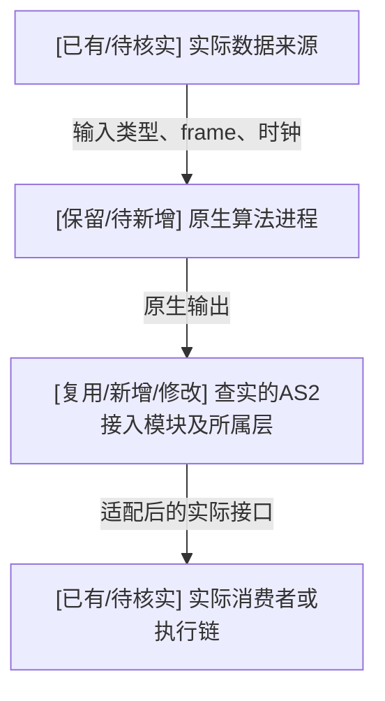

# <算法名> 接入 AeroHub/AS2 分析

> 填写真实发现并删除提示。代码路径、端点和版本必须来自核查；不适用项说明原因。
> 图中未知项标待核实，不画成已实现。本文是分析产物，不等于实施/验收完成。

## 1. 目标、范围与基线

- 用户目标/需要保留的能力：
- 本轮：分析 / 实施；目标：PC / RoboPi / 混合 / 其他明确环境。
- 算法来源、提交、核心入口与许可证依据：
- 项目、main约定、AS2/平台依赖的实际版本：
- 工作树修改、现有运行消费者与权威基线：
- 已知限制、必要假设与待用户补充信息：

## 2. 算法能力和现有数据流

| 保留能力 | 实际入口/核心实现 | 输入和来源 | 原生输出和消费者 | 证据 | 尚缺信息 |
| --- | --- | --- | --- | --- | --- |
| <能力> | <文件位置/提交> | <端点/格式> | <端点/格式> | <源码或实测> | <未知或无> |

描述当前实际链路；必要时画独立的现状图。区分已运行事实和仅有设计文档的部分。

## 3. 拟议架构及新增位置

将下图替换成算法实际需要的分层/进程图；可直接符合接口时删除多余Adapter节点。
画出PC/目标设备边界，保留不同职责的分支，避免为每层机械创建模块。
节点用已有/复用/新增/修改/待核实标记；边标明接口及数据/控制/依赖。

| 层/位置 | 模块及运行形态 | 复用/新增/修改 | 具体职责和调用者 | 为什么现有能力不足/可复用 | 依赖 | 验证 |
| --- | --- | --- | --- | --- | --- | --- |
| <Planner/Behavior/State Estimator/Perception/运行层等> | <节点/插件及宿主/进程> | <操作> | <行为> | <源码依据> | <提供方> | <观察结果> |

写明算法保留与适配分工。跨层的同一算法进程保持唯一，不将图中的逻辑职责误当成多份部署。

## 4. 依赖及运行拓扑

| 依赖/资源 | 消费模块 | 构建/运行；直接/间接 | 必需/可选 | 版本、ABI与提供方 | 当前可用性/证据 | 缺失处理 |
| --- | --- | --- | --- | --- | --- | --- |
| <算法库/ROS/接口包/AS2宿主/输入或地图/第三方库/SDK/设备等> | <消费者> | <分类> | <类别> | <实际值或待核实> | <已查实/文档声明/待核实> | <下一步> |

按需补充依赖DAG、主机生成器与目标库区分、PC/板端分工、启动顺序和资源占用。
资源消耗未测量时标待测；CPU/GPU、网络、传感器、外参和场景资产均以实际需要为准。

## 5. 接口契约及兼容差异

| 接口 | 源语义 | 目标消费者所需语义 | 转换/复用位置 | 保留条件与失效处理 | 核查/验证方法 |
| --- | --- | --- | --- | --- | --- |
| <Topic/Service/Action/插件/数据访问接口> | <具体内容> | <具体内容> | <模块> | <行为> | <证据或计划> |

覆盖适用项：单位/frame/原点/TF发布权、ROS/系统/单调时钟、采样与生效时间、频率/有效期、
QoS/发现、地图表示与重置、车辆目标映射、PVA缺省值、主/备用及滚动计划、生命周期。
指出不等价的接口、无法保留的能力和阻塞；不要用“同消息类型”代替语义核对。

## 6. 迁移流程表

| 阶段 | 前置条件 | 本轮动作与改动 | 产物/命令入口 | 通过条件 | 失败处理/回退 | 状态和证据 |
| --- | --- | --- | --- | --- | --- | --- |
| 基线与分析 | <输入> | <核查> | <版本/本报告> | <可检查条件> | <缺项> | <待验证/已通过/失败/不适用> |
| 最小移植/构建 | <依赖> | <适配> | <实际入口或拟新增入口> | <可加载/可调用> | <处理> | <状态> |
| 构造/接口/加载 | <环境> | <低成本检查> | <入口> | <类型支持、真实加载/调用结果> | <处理> | <状态> |
| 契约/生命周期 | <接口> | <适用用例> | <测试> | <明确结果> | <最小复现> | <状态> |
| 短场景闭环 | <前序通过> | <具体组合> | <入口> | <具体结果> | <处理> | <状态> |
| 指定完整PC场景 | <前序通过> | <原任务> | <入口和镜像> | <原任务判据> | <失败证据> | <状态> |
| 目标设备验证 | <目标包含设备且PC门槛满足> | <交叉编译/部署/接口/应用，分开记录> | <对应入口> | <逐层判据> | <回退> | <状态或不适用理由> |
| 交付 | <证据> | <提交与文档> | <版本/清单> | <可复现、有范围结论> | <限制> | <状态> |

按任务裁剪或拆分各阶段。报告不要声称尚未创建的命令当前可运行。

## 7. 验证矩阵与当前结论

| 场景/失败路径 | 输入与环境/版本 | 预期输出或行为 | 实际结果 | 证据 | 未覆盖部分 |
| --- | --- | --- | --- | --- | --- |
| <普通/异常/更新/取消/缺失输入/重置等适用项> | <值> | <判据> | <未运行或观测值> | <入口> | <限制> |

结论分别说明：分析已完成什么、实现已完成什么、验证通过到哪里、哪些失败仍未解释。
仅PC通过不意味着RoboPi通过；启动成功不意味着算法或任务闭环成功。

## 8. 版本管理与下一步

- 分支与分批提交、版本/镜像固定方式、冻结基线和原有修改保护：
- 输入/输出/日志保存位置与回退条件：
- 按依赖排序的下一步及阻塞解除条件：
