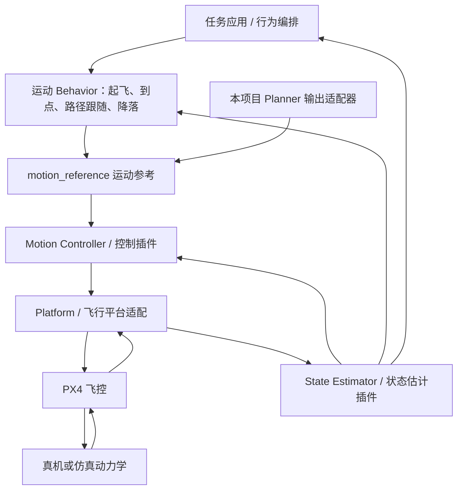

# Aerostack2 架构介绍

> 本文保留 Planner 设计与 main 历史集成参考。Gazebo 构建、启动和验收命令不属于当前分支；对应源码见[旧部署参考版本](history/README.md#旧部署参考版本)。当前运行入口见[部署导航](../deployment/README.md)。

本文介绍 Aerostack2 的核心分层，以及它在当前工程中的实际作用。实现核对日期：2026-11-03；以本项目锁定版本和启动配置为准，不代表所有 Aerostack2 版本的默认配置。

配套阅读：[统一 Planner 框架集成设计与使用](统一Planner框架集成设计与使用.md)。

## 1. Aerostack2 在系统中的位置

Aerostack2 是基于 ROS 2 的无人机软件框架。它把任务侧的运动需求连接到定位、运动控制和具体飞行平台，使上层应用可以使用相对统一的接口控制无人机。

在本工程中，三层软件各有职责：

| 层次 | 回答的问题 | 当前承担者 |
| --- | --- | --- |
| 任务与规划 | 哪些飞机去哪里，沿什么轨迹运动？ | 任务 YAML、统一 Planner framework、CAT-ORA 或 Swarm-Formation |
| 运动执行与平台适配 | 如何把参考运动转换为指定平台可执行的命令？ | Aerostack2 状态估计、运动控制、运动 Behavior、Pixhawk platform |
| 飞控与物理系统 | 如何维持飞行并驱动物理运动？ | PX4 飞控；仿真阶段由 Gazebo 提供动力学与传感环境 |

Aerostack2 不是本项目的路径规划算法，也不替代 PX4 飞控。Gazebo 是仿真环境，PX4 SITL 则是在计算机上运行的飞控软件。

## 2. 核心模块与分层



这是逻辑关系图；当前工程中每架无人机都有自己的 AS2 namespace 和执行组件，机群规划由上层框架统一管理。

### 2.1 任务应用与 Behavior

任务应用组织“先起飞、再移动、最后降落”等流程。Behavior 将一个有持续时间的动作封装为可启动、反馈结果和结束的执行单元，例如 Takeoff、Land、GoTo、FollowPath。

Behavior 与规划算法并不是同一个概念：规划算法计算参考轨迹，Behavior 负责某个动作的执行语义。原生 AS2 Behavior 有自己的 Action 和生命周期接口。

本工程已经启动 AS2 的运动 Behavior 组件，并使用起飞流程；但机群 Planner 的 `START/PAUSE/RESUME/CANCEL/GET_STATUS` 由自建 `/planner/control` 服务提供，尚未封装为原生 `as2_behavior::BehaviorServer`。独立 Mission Agent 也尚未实现。

### 2.2 State Estimator：统一状态反馈

状态估计层向上提供无人机的位姿等状态，并处理框架所需的坐标关系。它通过插件选择状态来源和处理方式。

当前启动的是 `raw_odometry` 插件，利用平台提供的里程计信息形成 AS2 状态输出。这里不是新接入了一套视觉 SLAM 或 LiDAR 定位算法。Planner 使用的位姿 topic 为：

```text
/drone0/self_localization/pose
/drone1/self_localization/pose
...
```

这些位姿在当前集成约定下属于逐机局部 ENU 坐标；上层机群规划会结合每架飞机的出生原点转换到共享 NED。

### 2.3 Motion Controller：执行运动参考

运动控制层接收位置、速度等参考，根据控制模式和插件配置形成平台命令。当前启动插件为 `pid_speed_controller`，配置还包含 `use_bypass`；实际使用哪条控制路径由模式与配置共同决定，不能仅凭插件名称认为所有指令都经过同一种 PID 运算。

本项目 Planner 输出端请求 `POSITION + YAW_ANGLE` 模式，向以下接口发布参考：

```text
/<namespace>/controller/set_control_mode
/<namespace>/motion_reference/pose
/<namespace>/motion_reference/twist
```

其中 `pose` 是位置和朝向参考；当前 adapter 写入 `twist` 的是各轴速度限制，不是 Planner 轨迹的速度前馈。运动控制与平台节点按配置持续执行参考。

### 2.4 Platform：隔离具体飞行平台

Platform 层连接 AS2 的通用运动接口与具体飞控协议。当前使用 `as2_platform_pixhawk`，负责 PX4 命令、控制模式、状态及里程计等接口适配。

PX4 与 ROS 2 之间通过 Micro XRCE-DDS Agent 通信。多机时，每个 PX4 实例具有独立 topic 前缀和 system id，AS2 namespace 与它们通过逐机配置对应。

例如当前 `drone0` 配置：

| 配置项 | 值 | 含义 |
| --- | --- | --- |
| AS2 namespace | `drone0` | 上层接口归属 |
| `fmu_prefix` | `/px4_10` | 对应 PX4 topic 前缀 |
| `target_system_id` | `11` | PX4 命令目标系统 |
| `cmd_freq` | `50.0` | 平台命令频率配置 |

因此 `drone0` 不等于 PX4 instance 0；映射必须查部署配置。当前 PX4 instance 从 10 开始。

## 3. 本项目的实际部署

完整 Compose 包含六个服务：

| Compose 服务 | 容器名 | 职责 |
| --- | --- | --- |
| `as2` | `planner-as2-seven` | XRCE Agent 与七机 AS2 执行组件 |
| `px4` | `planner-px4-seven` | 七个 PX4 SITL 实例与 Gazebo |
| `clock` | `planner-clock` | 将 Gazebo 时间发布为 ROS 2 `/clock` |
| `runtime` | `planner-runtime` | 统一 Planner framework，以及任务启动的 ROS 2 adapters |
| `cat-ora` | `planner-cat-ora` | CAT-ORA ROS 1 算法与代理 |
| `swarm-formation` | `planner-swarm-formation` | Swarm-Formation ROS 1 算法与代理 |

AS2 服务为 `drone0` 至 `drone6` 分别启动四类组件：

1. `as2_platform_pixhawk`；
2. `as2_state_estimator`，使用 `raw_odometry`；
3. `as2_motion_controller`，使用 `pid_speed_controller`；
4. `as2_behaviors_motion`。

这是一套“上层统一管理机群、下层逐机执行”的结构。两个 ROS 1 算法服务可以同时驻留，但框架只允许一个活跃 Planner 任务。

## 4. 一条运动指令如何形成闭环

以 CAT-ORA 四机任务为例：

1. 外部起飞脚本经 AS2 接口依次完成七机解锁、Offboard 和起飞。
2. 用户启动四机 Planner 任务，adapter 获取实际位置并向算法请求轨迹。
3. Output Gateway 校验全机群轨迹，按仿真时间采样四架参与飞机的位置参考。
4. AS2 setpoint adapter 把逐机本地 NED 转为本地 ENU，发布到各机 `motion_reference`。
5. AS2 控制与平台链路将参考送至对应 PX4；PX4 在 Gazebo 中驱动飞机运动。
6. 实际位姿经平台与状态估计返回，Planner framework 判断四机是否同时到达各自目标并保持指定时长。

剩余三机不参与该 Planner 任务。成功判定使用状态反馈，不以“轨迹已发布”或“轨迹时间结束”代替到达判定。

## 5. 坐标、时钟与通信

### 坐标

| 边界 | 采用的约定 |
| --- | --- |
| 任务目标、统一轨迹 | 机群共享 `LOCAL_NED`：北、东、下 |
| Gateway 输出 | 减去各机原点后的逐机本地 NED |
| AS2 位置参考和定位反馈 | 逐机局部 ENU：东、北、上 |
| PX4 | NED 世界坐标和 FRD 机体系语义 |

本地位置转换为 `ENU = (NED.y, NED.x, -NED.z)`；yaw 转换为 `wrap(π/2 - yaw_ned)`。机群共享原点到逐机原点的平移由本项目 Gateway 负责，不交给 AS2 自动推断。

### 时钟

AS2 和 Planner runtime 使用 `use_sim_time=true`，以 Gazebo/ROS `/clock` 为轨迹执行与任务计时依据。仿真暂停时，相关仿真时间计时也停止推进；Shell 验收脚本的等待期限则使用宿主时间。

### 通信

当前 Compose 使用 Linux host network、`ROS_DOMAIN_ID=80` 和 `FASTDDS_BUILTIN_TRANSPORTS=UDPv4`。使用 UDP 是为避免不同容器 IPC 隔离导致 Fast DDS 共享内存通道不可用。

定位订阅使用 sensor-data QoS。仅能发现 topic 并不意味着 QoS 匹配或数据已经收到；运行检查应同时核对 `/clock`、实际位姿、控制服务和飞控状态。

## 6. 扩展能力与当前边界

Aerostack2 的模块和插件边界为更换状态估计、控制器或平台适配提供基础。本项目的统一 Planner 位于这些执行模块之上，因此未来替换算法时可以保留 AS2/PX4 执行链。

但当前实现不自动提供以下能力：

- Mission Agent 自动拆解任务并编排起降；
- 完整 Model Hub、硬件自动匹配和远程部署；
- 多 Planner 并行协作或运行中热切换；
- 真机、国产操作系统和算力板在环验收。

框架的暂停、取消和失败处理会尝试发布当前位置悬停参考，但需要已有完整机群位置且输出链可用。进程退出、通信断开或定位丢失时，不能把该动作视为独立可靠的安全系统；PX4 自身的失联保护仍属于另一层机制。

## 7. 源码与配置入口

| 入口 | 阅读重点 |
| --- | --- |
| AS2 多机启动（main: `deployment/platform/run_multi_as2.sh`） | 每架飞机启动哪些组件 |
| AS2 通用配置（main: `deployment/platform/config.yaml`） | 仿真时间、状态估计、运动 Behavior 插件 |
| [控制器配置](../config/as2/pid_speed_controller.yaml) | 控制参数与 bypass 配置 |
| drone0 平台配置（main: `deployment/platform/multi/drone0.yaml`） | PX4 前缀、system id 和频率 |
| Compose（main: `deployment/integration/compose.yaml`） | 容器、网络与目录挂载 |
| [AS2 输出 adapter](../planner_framework/bridges/as2_setpoint/uav_as2_setpoint_adapter/node.py) | 坐标转换、控制模式和运动参考 |
| PX4 v1.17 兼容补丁（main: `deployment/platform/patches/as2-platform-px4-v1.17.patch`） | 锁定版本之间的消息兼容处理 |
| 上游版本清单（main: `deployment/upstream.repos`） | Aerostack2、Pixhawk platform、px4_msgs 锁版 |

[返回文档导航](README.md)
