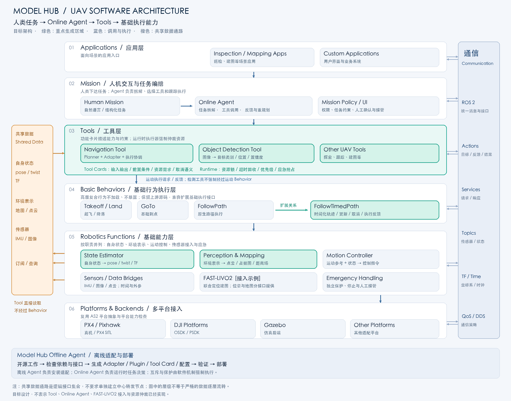

# 项目简介

整理日期：2026-11-06。本文件是该类别的唯一主文档。

<a id="overview"></a>

三份受 Git 跟踪的主文档：[AS2 简介](as2简介.md) · [项目简介](项目简介.md) · [开发者贡献指导](开发者贡献指导.md)

## 内容导航

- [当前目录与职责](#part-1)
- [目标架构与设计理由](#architecture-design)
- [统一 Planner 设计、接口与使用](#part-2)
- [目录重组后的多机验收](#part-3)

<a id="part-1"></a>

## 1. 当前目录与职责

<a id="part-1-远端项目目录"></a>

### 远端项目目录

主工作目录：`RKOH_Remote:/home/noah/code/UAV/aerostack2-integration`。

```text
aerostack2-integration/
├── src/
│   ├── planner/
│   │   ├── cat_ora/             # upstream、ros2_adapter、ros1_proxy
│   │   ├── swarm_formation/     # 与 cat_ora 相同的三层
│   │   ├── framework/           # 配置、轨迹校验、机群调用与生命周期
│   │   └── interfaces/          # ROS 2 消息、服务和 FollowTimedPath Action
│   ├── behavior/
│   │   ├── follow_path/         # 兼容扩展 AS2 FollowPath Behavior
│   │   └── legacy_setpoint/     # 显式启用的历史执行链路
│   ├── state_estimator/         # 自身状态估计与定位接入，当前无实现
│   └── perception/              # 环境感知、建图与环境表示，当前仅占位
├── as2/
│   ├── aerostack2/              # 官方 AS2 核心子模块
│   ├── as2_platform_pixhawk/    # 官方 PX4 平台适配子模块
│   └── px4_msgs/                # PX4 ROS 2 消息子模块
├── px4/                         # PX4-Autopilot 子模块
├── simulator/
│   └── gazebo/                 # AS2 官方 project_gazebo 子模块
├── deployment/                 # 构建、平台补丁、Compose 与启动入口
├── vendor/                     # 锁定版本的通信依赖源码压缩包
├── tools/                      # 场景及演示工具
├── docs/                       # 架构、设计、使用与历史说明
├── log/                        # 全部忽略：测试日志、配置、缓存、构建及迁移备份
├── .gitmodules                 # 子模块路径与公开上游地址
├── AGENTS.md                   # 架构及开发约束
└── README.md                   # 使用入口
```

`src/planner/cat_ora/upstream` 与 `src/planner/swarm_formation/upstream` 中的算法仍归各自上游所有，目录位于集成代码区不代表原创。
`simulator/gazebo` 是 AS2 官方仿真工程，不是 Gazebo 引擎的 fork。
当前 PX4/Gazebo 多机测试使用 PX4 自带的 Gazebo 集成及镜像提供的 Gazebo Harmonic，
不要求启动 `project_gazebo`，也不把两个仿真入口混为一套。

新克隆使用 `git clone --recurse-submodules`，已有克隆使用
`bash deployment/prepare_sources.sh`。子模块版本由外层 Git gitlink 锁定。
不提交 `log/`；项目根目录不再存放运行日志。基础镜像仍需按部署说明准备。

修改任务使用 `src/planner/framework/examples/`，修改算法默认参数使用
`src/planner/framework/registry/`，运动执行扩展位于 `src/behavior/follow_path/`。
详细统一接口和运行方式见 `项目简介.md`。

<a id="architecture-design"></a>

## 2. 目标架构与设计理由

本节描述 Model Hub 的目标架构，不代表 Online Agent、Tool 层、资源仲裁和 FAST-LIVO2 接入已经实现。现有两个 Planner 的集成是后续 Navigation Tool 的实现基础。应用层与多平台接入沿用 AS2；Mission 层保留任务编排职责，并增加以人机交互和 Online Agent 为中心的任务入口。



### 2.1 Mission、Tool 与 Behavior 的职责

人类通过自然语言或结构化界面下达 Mission。Online Agent 在任务约束内拆解目标、选择工具、处理反馈、调整后续步骤，并支持人工接管。Python API 或行为树仍可作为确定性的编排实现，Online Agent 不直接承担高频飞行控制。

Tool 提供面向任务的能力。Navigation Tool 包含规划算法、Adapter 和执行协调，根据当前位置、地图和目标规划并调用基础 Behavior；Object Detection Tool 消费图像并返回检测结果，不需要为了运行检测而调用运动 Behavior。检测结果中的“位置”可以是图像框，也可以是具备深度与定位条件后的三维位置，必须在接口中明确。

基础 Behavior 层保留起飞、降落、基础到点、路径执行等能力及其 Goal、Feedback、Result、暂停和取消语义。高层复合 Behavior 在本项目部署中不加载、不对外暴露，其任务职责转移到 Tool；保留上游源码，减少 fork 维护。表达能力不足时做兼容扩展，例如 FollowPath 增加 FollowTimedPath 入口，承接时间化轨迹和更新。图中二者间的箭头表示扩展关系，不表示先执行 FollowPath 再执行 FollowTimedPath。

### 2.2 调用链与数据通路分开

蓝色链路表示任务请求和动作执行；反馈、结果沿接口返回调用方。橙色共享数据通路表示传感器测量、状态和环境表示可由 Tool 直接订阅或查询，不经过 Behavior 中转。它是一组逻辑接口，不要求新增中心化转发节点；实际可使用 ROS 2 Topic、Service 和 TF。右侧通信模块是承载这些接口的跨层基础设施，不是另一个任务调度器。

Navigation Tool 可以直接使用状态估计、地图，以及算法确实需要的图像或点云；应优先消费已有处理结果，避免无必要地重复定位建图。读取共享数据和取得控制权是两件事：多个 Tool 可以读取同一份状态，但不能未经协调同时控制同一架无人机。Motion Controller 和 Behavior 也直接消费状态估计，不需要 Tool 转发。

### 2.3 自身状态估计与环境感知并列

State Estimator 回答“无人机自身在哪里、如何运动”；Perception & Mapping 回答“周围有什么、哪里可通行”。两者适合放在基础能力层并列，通过传感器输入和位姿／TF 协作，不应把环境地图强行编码进自身状态接口。

| 基础能力 | 输入示例 | 输出及消费者 |
| --- | --- | --- |
| 传感器驱动与数据桥 | 平台或外接 IMU、相机、雷达 | 带时间戳、单位和坐标系的测量；供估计、感知及需要它们的 Tool 使用 |
| State Estimator | 由插件决定：里程计、动捕、仿真状态，或自定义融合插件的传感器输入 | `self_localization/pose`、`self_localization/twist`、TF；供控制、Behavior、Tool 使用 |
| Perception & Mapping | 图像／点云，以及配准所需的位姿、时间同步与外参 | 目标、点云地图、占据图或距离场等环境表示；供导航、检测和应用使用 |
| Motion Controller | 运动参考与当前状态 | 平台支持的控制指令 |

“在传感器上增加处理层”描述数据处理顺序，是可行的；在职责图中，这些处理模块应与 State Estimator 同属基础能力层。默认不扩展 State Estimator 为包办全部感知的模块。若需要新的定位算法，则扩展其估计插件或接入适配器；若需要地图构建与查询，则提供独立的环境表示接口。这里的 Perception & Mapping 是本项目目标职责划分，不宣称 AS2 已经提供满足全部需求的通用实现。

原生 State Estimator 不等于“固定输入 IMU、固定运行 EKF”。当前锁定源码中，`raw_odometry::Plugin::on_setup()` 订阅可配置 `odom_topic` 的 `nav_msgs/msg/Odometry`，默认是 `sensor_measurements/odom`；它可以直接整理飞控已有的估计结果。插件基类提供 `geometry_msgs/msg/PoseStamped`、`geometry_msgs/msg/TwistStamped` 的统一发布接口和 TF 辅助能力。`mocap_pose`、`ground_truth` 等插件采用其他定位输入；具体订阅与融合逻辑由插件实现。

FAST-LIVO2 可以在同一算法进程内联合定位建图，不要求为了职责分层把它拆成两个独立估计器：位姿／里程计结果由 State Estimator Adapter 接入统一自身状态；点云或地图结果由地图 Adapter 提供给环境接口。导航算法若要求占据图或 ESDF，而上游只提供点云，还需要专门的表示转换与地图更新模块，不能假定已经具备。地图数据与位姿须对齐坐标系和时间，处理定位重置及地图版本变化。

单架无人机的主状态输出和同一 TF 变换应有明确发布权。若 PX4 需要使用外部定位，另行配置外部里程计桥与 EKF 融合；AS2 获取该定位不代表 PX4 自动使用它。

### 2.4 功能卡片、Agent 规范与软件互斥

每个 Tool 应有机器可读的功能卡片，说明工具名称和版本、输入输出 schema、适用车辆、前置条件、所需数据及其新鲜度、资源需求、超时、反馈、取消和失败语义。资源应按具体实例命名，例如 `drone0.motion`、`drone0.gimbal`，而不是把整个机群无条件设为同一把锁。

Online Agent 只能调用已注册工具，遵守任务权限和参数约束，区分“请求接受”与“任务完成”，处理失败、超时、取消和人工接管。功能卡片是声明，Agent 的规范也不能替代软件检查：工具运行时在执行前校验配置、原子获取资源，执行期间监督健康状态，结束时释放资源。超时或进程死亡时，应先确认旧动作停止，再允许新任务取得控制权。

例如导航与降落都写入 `drone0.motion`，必须互斥或按明确优先级完成交接；只读相机的检测可以与导航并发，但切换相机模式、操作云台和占用有限 GPU 资源仍需独立仲裁。基础 Behavior 入口也应限制绕过仲裁的直接调用；应急处理具有独立的保护路径和抢占优先级，不依赖 Online Agent 及时响应。

### 2.5 Offline Agent 与 Online Agent 分工

Model Hub 的 Offline Agent 负责选定开源工作后的依赖检查、适配代码、功能卡片、启动配置和验证，随后将组件部署到 Tool 或基础能力层。Online Agent 在运行时依据人类 Mission 调用这些已部署能力。将安装适配与飞行决策分开，可以独立控制版本、验证范围、运行权限和故障处理。

本架构优先集中研究 Tool 接入与状态估计，同时明确环境表示接口，避免所有外部算法都被塞入同一种 Behavior 或同一个 State Estimator。接口和生命周期可以统一，算法源码及进程边界仍可独立；具体实现形式由依赖、性能和扩展点决定。


<a id="part-2"></a>

## 3. 统一 Planner 设计、接口与使用

<a id="part-2-aerostack2-统一-planner-第一阶段接口与配置设计"></a>

### Aerostack2 统一 Planner 第一阶段接口与配置设计

本文是统一 Planner 的主文档，集中维护集成设计逻辑、模块间接口数据形式、配置、使用方式、验收结果与实现边界。原独立设计说明、使用指南和验收摘要已合并至此。

本文面向需要理解、运行或扩展当前工程的开发者。FollowPath 扩展及复验更新至 2026-11-04；旧链路的历史动力学结果见[最终验证记录](../log/resolved/FINAL_VERIFICATION.md)，不能代替本次扩展验收。

Aerostack2 的分层与执行链介绍见 [Aerostack2 架构介绍](as2简介.md#part-1)。

<a id="part-2-执行层能力划分与-followpath-扩展2026-11-04"></a>

#### 执行层能力划分与 FollowPath 扩展（2026-11-04）

本项目将“执行层”限制为执行确定的动作或运动计划。原生 AS2 中 Behavior 是可组合的运行封装，不意味着所有 Behavior 都属于本项目的执行层。以下分类不修改上游职责定义。

| 本项目执行能力 | 复用的原生组件 | 边界 |
| --- | --- | --- |
| 起飞、降落 | Takeoff、Land | 处理单次起降，不决定任务路线 |
| 飞向指定点 | GoToWaypoint | 适用于无需外部规划保证的到点动作，不替代避障规划 |
| 跟随几何路径 | FollowPath 原生接口与插件 | 允许原生执行侧决定时间和连接方式 |
| 跟随外部时间化轨迹 | FollowPath 扩展接口 | 保留 Planner 给定的时间、机体对应关系和更新语义 |
| 持续跟随参考 | FollowReference | 跟踪目标点/参考坐标系，不承担任务决策 |
| 悬停及终止运动 | Motion Reference Hover 与 Behavior 取消处理 | Hover 是底层参考处理器，不虚构独立原生 Hover Action |
| 解锁、Offboard 切换 | SetArmingState、SetOffboardMode | 平台执行准备能力 |
| 云台、夹爪操作 | PointGimbal、GripperHandler | 载荷动作 |
| 目标检测、质量/力估计 | ObjectPerception、MassEstimation、ForceEstimation | 可调用的感知/估计能力，不属于运动执行器 |

GeneratePolynomialTrajectory 是“航点转轨迹并执行”的可选后端：原生 FollowPath 可以继续调用它；外部 Planner 已提供时间化轨迹时不再重新生成。PathPlannerBehavior/NavigateToPoint 包含路径规划，放到本项目的 Mission 测试场景中，而不作为外部 Planner 的执行后端。SwarmFlocking 同理可以作为编队任务基线，不能替代 CAT-ORA/Swarm-Formation 的轨迹执行。

Mission 测试任务按组合定义：起飞→到点→降落；起飞→NavigateToPoint 导航→降落；多机起飞→Planner 编队变换→悬停→降落。测试应分别检查动作 Result、实际位置、路径/时间约束和失败收口，不能仅以任务脚本退出码判定运动成功。这些是测试任务边界，不是在当前阶段引入 Agent 或完整任务规划系统。

<a id="part-2-兼容扩展方式"></a>

##### 兼容扩展方式

`uav_follow_path_execution` 在独立包中继承原生 `FollowPathBehavior`，链接锁定版本的 `follow_path_component`。原生 `as2_msgs/action/FollowPath` 类型保持不变；新增同一执行组件的 `follow_timed_path` Action。部署时用扩展节点替换原生 FollowPath 节点，不能把二者同时启动到同一命名空间。两种入口互斥，普通请求仍委托原生插件执行。

`FollowTimedPath` 的 Goal 包含 `TimedPath`：接口版本、task_id、vehicle_id、revision、固定 ENU frame_id、generated_at、valid_from、is_final、有效字段位图、轨迹点以及 max_speed。轨迹点使用 time_from_start 与位置，可选速度/加速度/yaw。Planner 的 fleet NED 数据须在调用前转换到各机固定 ENU 坐标系；禁止把移动 TF 当作固定轨迹系使用。

时间化模式拒绝过期起点、乱序时间、重复版本、非有限值和不连续替换。位置数据采用分段线性插值；有速度时采用三次 Hermite；有速度与加速度时采用五次插值，各阶导数来自同一曲线。采样后轨迹仍需由 Planner/适配器验证动力学和避碰约束，插值不构成新的避碰证明。

Swarm-Formation 仿真时 ROS 1 也启用 `/use_sim_time`。Gazebo 时钟代理将同一时间包分别发送至 ROS 2 桥的 UDP 28502 和 ROS 1 代理的 UDP 28503；adapter 指定 valid_from，代理按该时刻采样并原样返回。禁止用墙钟采样后重新贴仿真时间戳。代理同时返回原多项式一阶、二阶导数 velocities_enu 与 accelerations_enu，供五次插值与前馈使用。跨多项式分段边界仍需验证插值误差，不能宣称采样表示无损。

执行组件将速度、加速度参考完整传给 Motion Reference，但控制器能否利用这些量取决于插件。锁定版本的 `pid_speed_controller` 轨迹模式使用位置/速度误差生成速度输出，不直接叠加速度前馈，也不消费加速度前馈。本部署将 trajectory_control 的 kp 从 0.4 调为 1.5 以减少时间化轨迹跟踪滞后，其余运动模式保持原配置；这不是对任意动力学或真机的通用参数保证。

该 PID 的轨迹输出速度上限从 POSITION 模式的 twist 继承；起飞可能留下零水平限速。含导数的时间化模式会在 valid_from 前通过位置保持参考设置 max_speed，随后按原时刻进入轨迹模式；准备期间只保持实际位置，不提前执行规划点。

Swarm 上游还用 `start_time < 1e9` 作为未初始化标志，因此 ROS 1 `/clock` 使用固定 `1700000000` 秒历元加 Gazebo 时间，代理将请求的 valid_from 加上相同偏移后采样，再返回未偏移的 ROS 2 时间。该偏移不改变经过时间或规划时长，不是墙钟同步。

更新通过 `follow_timed_path/_behavior/modify`，保留当前轨迹直到替换生效时间。暂停会悬停并要求重新规划，不允许单机自行平移原轨迹时间后恢复；调用方须取消原 Goal，再以新的共同生效时间提交机群计划。非最终段耗尽应报错，最终段须在实际位置达到容差后成功。一个单机 Action 的接受不等于全机群事务提交，多机协调与拒绝收口仍须由调用端实现。

衔接校验使用独立的位置、速度、加速度与 yaw 容差。部署中位置为 0.15 m、速度为 0.5 m/s、加速度为 1.4 m/s²、yaw 为 0.15 rad；加速度值按当前 Swarm 每轴 ±0.4 m/s² 的两端向量变化范围设置。容差意味着有界跳变而非严格 C² 连续；需要严格连续或 jerk 约束的 Planner 应提供精确拼接段并收紧配置，不能把此检查视为避碰或动力学可行性证明。

已实现接口、采样核心、扩展组件、机群 Action 调用与部署替换。默认 `execution_backend=follow_path`；`legacy_setpoint` 是显式历史对照选项。2026-11-04 已通过 Humble 镜像构建、接口回归、CAT-ORA 四机和 Swarm-Formation 七机动力学验收。第 13 节历史结果不作为本次扩展的证据。

当前版本复验：CAT-ORA 四机 1 段、Swarm 七机 285 段均返回 SUCCEEDED/NONE。Swarm 曾因基础镜像保留了演示目标 x=24 而非任务目标 x=-4，继续向地图外规划并触发紧急停止；构建现在按 XML 参数名称设置航点，缺项立即失败。七机请求的提前量设为 0.5 秒，解决 0.2 秒窗口内确认超时；代理按未来时刻采样，不重新贴时间戳。连续性阈值未因此放宽。

Swarm 本轮各机最大跟踪误差约 0.31–0.62 m，CAT-ORA 约 0.62–0.65 m；0.15 m 是轨迹交接容差，不是全程跟踪精度保证。验收使用现有无障碍仿真场景，不代表任意障碍环境或真机可用。算法输出不连续时仍拒绝更新并停止机群，不自动拼接未经验证的避障轨迹。详细证据见 FollowPath 实现与验收记录（远程本地资料，不随仓库分发）。

<a id="part-2-构建调用与测试入口"></a>

##### 构建、调用与测试入口

正常构建仍执行 `docker compose -f deployment/integration/compose.yaml build`，随后重建 as2/runtime/clock 容器。AS2 服务现在使用包含扩展包的 runtime 镜像；只含上游的基础镜像仍支持原生启动。扩展启动文件 `src/behavior/follow_path/launch/motion_behaviors.launch.py` 复用上游起飞、降落、到点启动逻辑，仅替换 FollowPath 节点。

逐机接口：

| 名称 | 类型/语义 |
| --- | --- |
| `/<ns>/FollowPathBehavior` | 原生 `as2_msgs/action/FollowPath`，保持兼容 |
| `/<ns>/follow_timed_path` | `uav_planner_interfaces/action/FollowTimedPath` |
| `/<ns>/follow_timed_path/_behavior/modify` | `FollowTimedPath_SendGoal` service，与 AS2 修改接口惯例一致 |
| `.../_behavior/pause` | Trigger；悬停并使原时间计划不可恢复 |
| `.../_behavior/resume` | Trigger；返回 REPLAN_REQUIRED，不擅自修改机群时序 |
| `.../_behavior/stop` | Trigger；终止该执行并悬停 |
| `.../_behavior/behavior_status` | `as2_msgs/BehaviorStatus`，IDLE/RUNNING/PAUSED |

本项目 `/planner/control RESUME` 会等待全机停止确认，再重新规划，因此不直接调用上述拒绝原地恢复的 timed resume 接口。原生 FollowPath 的暂停恢复仍委托原生插件，未改为上述策略。

在已 source ROS 与 workspace 的 Linux 环境执行：

```bash
colcon test --merge-install --packages-select uav_follow_path_execution
colcon test-result --verbose
python3 src/behavior/follow_path/tests/ros_smoke.py
```

ROS smoke 使用真实扩展节点与 Action，但控制器是模拟响应器，覆盖普通 FollowPath 执行、互斥、未来生效、过期拒绝、滚动更新、暂停/重新规划要求、取消和覆盖耗尽。动力学测试入口为 `src/behavior/follow_path/tests/compose.sitl.yaml` 和 `run_sitl_case.py`；容器启动后在 runtime 内执行后者，参数为 `cat_ora` 或 `swarm_formation`。每种算法验收应从重新初始化的仿真状态开始，测试 Compose 与默认部署共用端口，不可同时运行。

<a id="part-2-阅读导航"></a>

#### 阅读导航

- [第 1 节：为什么要统一 Planner](#part-2-section-1)
- [第 2 节：组件关系与接口](#part-2-section-2)
- [第 3 节：两个算法如何接入](#part-2-section-3)
- [第 4 节：配置为何分成四类](#part-2-section-4)
- [第 5 节：轨迹契约、坐标和时间](#part-2-section-5)
- [第 6 节：生命周期与完成条件](#part-2-section-6)
- [第 7 节：使用前准备](#part-2-section-7)
- [第 8 节：一键运行现有示例](#part-2-section-8)
- [第 9 节：手动启动与任务控制](#part-2-section-9)
- [第 10 节：验证与排障](#part-2-section-10)
- [第 11 节：后续接入新 Planner](#part-2-section-11)
- [第 12 节：实现入口](#part-2-section-12)
- [第 13 节：第一阶段验收与证据](#part-2-section-13)
- [第 14 节：版本、部署注意事项与后续范围](#part-2-section-14)

<a id="part-2-section-1"></a>

<a id="part-2-1-为什么要统一-planner"></a>

#### 1. 为什么要统一 Planner

CAT-ORA 和 Swarm-Formation 的内部工作方式不同：前者集中计算有限轨迹，后者持续输出滚动轨迹。如果上层任务直接调用各自原生接口，就需要分别处理参数、坐标、时间、状态、超时和控制输出。

本工程把这些公共问题提取为框架，保留算法原有实现，并用 adapter 消化差异。用户通过任务配置选择 Planner；执行侧始终接收相同的机群轨迹契约。

| 公共部分 | 统一后的职责 |
| --- | --- |
| Registry | 按算法 id 和精确版本定位 manifest、参数模板和 schema |
| 任务解析 | 校验车辆、目标和部署映射，合并参数并保存 resolved config |
| 生命周期 | 启动、暂停、恢复、取消、状态查询与失败收口 |
| 轨迹契约 | 全机群、带时间信息的 `TimedTrajectorySegment` |
| Output Gateway | 整段校验、插值、过期处理及逐机原点转换 |
| AS2 输出适配 | 将参考送入各机 Aerostack2 执行链 |
| 完成判定 | 使用实际位置确认整个机群完成任务 |

当前是“单个活跃任务选择一个 Planner”。ROS 1 算法容器由 Compose 预先启动；framework 启动的是对应 ROS 2 adapter 子进程，并不根据 manifest 自动创建或调度容器。

<a id="part-2-section-2"></a>

<a id="part-2-2-组件关系与接口"></a>

#### 2. 组件关系与接口

```mermaid
flowchart TB
    TASK[任务 YAML + 部署 YAML] --> FW[Planner framework / Registry / 生命周期]
    FW --> ADAPTER[所选 ROS 2 Planner adapter]
    ADAPTER <-->|TCP / JSON| PROXY[ROS 1 proxy + 原生算法]
    ADAPTER -->|/planner/trajectory| GW[Output Gateway：framework 内部]
    GW --> CLIENT[机群 FollowPath 调用协调]
    CLIENT -->|FollowTimedPath Actions| OUT[逐机扩展 FollowPath]
    OUT --> AS2[Motion Reference / AS2 控制与平台]
    AS2 --> PX4[PX4 SITL + Gazebo]
    AS2 -->|实际位姿| FW
    AS2 -->|实际位姿| ADAPTER
    FW --> STATUS[/planner/status]
```

Gateway 是 framework 内部逻辑，不是单独的 Compose 服务。统一接口的 ROS 包名为 `uav_planner_interfaces`，源码目录为 `src/planner/interfaces`。

| 接口 | 类型 | 用途 |
| --- | --- | --- |
| `/planner/control` | `ControlPlanner` service | 控制任务和查询状态 |
| `/planner/trajectory` | `TimedTrajectorySegment` topic | adapter 输出全机群轨迹 |
| `/planner/failure` | `PlannerFailure` topic | adapter 报告失败 |
| `/<vehicle>/follow_timed_path` | `FollowTimedPath` Action | 默认后端：带时间的路径执行与结果 |
| `/planner/setpoints` | `FleetSetpoint` topic | 仅 legacy_setpoint 后端使用 |
| `/planner/status` | `BehaviorResult` topic | 任务状态；不是固定频率的持续遥测 |
| `/<vehicle>/self_localization/pose` | `PoseStamped` topic | 实际位置反馈 |

任务控制接口仍是项目自建服务；执行侧已使用扩展原生 FollowPath 的 Action。`BehaviorResult` 消息虽然定义了 `vehicle_results`，当前节点主要填写机群状态、任务 id 和原因码，逐机 Action 的结果由协调器汇总，尚未写入该数组。

<a id="part-2-21-接口数据总览"></a>

##### 2.1 接口数据总览

下文以实际源码为准区分磁盘文件、ROS 消息和 socket 数据。ROS 数据用 YAML 或字段树展示，JSON 用于 TCP 代理；展示格式不表示所有接口都使用 JSON。

| 发送方 → 接收方 | 通信形式 | 数据结构 | 关键语义 |
| --- | --- | --- | --- |
| 使用者 → framework | ROS 2 service | `ControlPlanner.Request` | 命令及容器内配置文件路径 |
| Registry → framework | Python 字典 | resolved config | 生成 task_id，合并参数并附带部署信息 |
| framework → 两类 adapter | YAML 文件 + 进程参数 | resolved config | `resolved_config:=文件路径`；不是通过 ROS topic 发送配置 |
| AS2 → framework、Planner adapter、输出 adapter | ROS 2 topic | `geometry_msgs/PoseStamped` | 逐机局部 ENU 位姿 |
| CAT-ORA adapter ↔ ROS 1 proxy | TCP 28500，逐行 JSON | 起终点及参数 ↔ 逐机轨迹点数组 | 机群共享 ENU，车辆靠数组顺序对应 |
| Swarm adapter ↔ ROS 1 proxy | TCP 28501，逐行 JSON | 机群状态及编队中心 ↔ 逐机轨迹点数组 | 固定 drone0…drone6，机群共享 ENU |
| ROS 1 proxy ↔ 原生算法 | ROS 1 service / topics | CAT-ORA 服务、Odometry、PoseStamped、PolyTraj | 保留各算法原生接口 |
| Planner adapter → framework/Gateway | ROS 2 topic | `TimedTrajectorySegment` | 完整机群、共享 NED、明确执行时间 |
| framework → 扩展 FollowPath | ROS 2 Action / modify service | `FollowTimedPath` / `TimedPath` | 原生时间基准、逐机 ENU、版本和完整轨迹 |
| 扩展 FollowPath → AS2 控制器 | Motion Reference handlers | 位置或轨迹参考 | Behavior 内采样执行；有导数字段时传递前馈 |
| Planner adapter → framework | ROS 2 topic | `PlannerFailure` | task_id、原因码、诊断文本 |
| framework → 使用者 | ROS 2 service response / topic | `BehaviorResult` | 任务状态与失败原因 |
| Gazebo 时钟代理 → ROS 2 时钟桥 → 节点 | UDP 28502 → ROS 2 topic | 12 字节时间包 → `rosgraph_msgs/Clock` | 仿真时间基准 |

<a id="part-2-22-配置文件与进程启动接口"></a>

##### 2.2 配置文件与进程启动接口

任务 YAML 描述“做什么”，部署 YAML 描述“车辆在哪里、状态从哪里读”。完整任务示例见第 4 节。部署文件中的单机条目如下，实际文件必须完整包含任务所选车辆：

```yaml
drone0:
  px4_origin_in_fleet_ned: [-4.5, -12.0, 0.0]
  namespace: /drone0
  topics:
    pose: /drone0/self_localization/pose
```

`px4_origin_in_fleet_ned` 是该机局部原点在共享 NED 中的位置，单位米。namespace 和 topic 为 ROS 名称。部分旧示例还含 `trajectory_setpoint`，当前 AS2 adapter 不读取它，而是根据 namespace 构造 `motion_reference` topic。

Registry 的输出先作为 Python 字典返回，framework 再补充时间配置并写成 YAML。主要字段为：

```text
resolved config
├── task
│   ├── name: string
│   └── task_id: string                 # 每次 START 生成的 UUID
├── planner
│   ├── id: string
│   ├── version: string                 # 精确版本
│   ├── manifest: string                # manifest 绝对路径
│   ├── runtime: {image, adapter, command[]}
│   └── parameters: mapping             # 默认值与任务覆盖合并后的结果
├── vehicles: string[]                  # 有序车辆列表
├── targets: {vehicle_id: {x, y, z}}     # 共享 NED，米
├── completion: {position_tolerance, hold_duration, task_timeout}
├── coordinates: {frame: LOCAL_NED, body_frame: FRD}
├── deployment: {vehicle_id: 部署条目}
└── time: {use_sim_time: true, clock_topic: /clock}
```

framework 将文件路径填入 manifest 的 `runtime.command`，以子进程启动所选 Planner adapter；同时启动 AS2 输出 adapter。两者均通过 `resolved_config` 参数读取同一份配置，并通过独立的 ROS 参数 `use_sim_time` 设置时钟。

暂停时停止的是 ROS 2 Planner adapter 子进程，不是 Compose 中常驻的 ROS 1 算法服务。恢复时重新启动 adapter，重新读取相同任务的 resolved config。

<a id="part-2-23-使用者与-framework控制和结果"></a>

##### 2.3 使用者与 framework：控制和结果

`/planner/control` 的服务定义等价于：

```text
Request
  uint8 command                       # START=0 / PAUSE=1 / RESUME=2 / CANCEL=3 / GET_STATUS=4
  string task_config_path             # START 时使用，runtime 容器内路径
  string deployment_config_path       # START 时使用，runtime 容器内路径
---
Response
  bool accepted                       # 本次控制命令是否被接受
  string message                      # 控制响应或拒绝原因
  BehaviorResult result
    string behavior_type              # 当前为 "planner"
    string task_id
    uint8 overall_status              # REJECTED=0…CANCELED=5
    string failure_reason             # NONE、INVALID_TASK、TASK_TIMEOUT 等
    VehicleResult[] vehicle_results
      string vehicle_id
      uint8 status
      string failure_reason
      string detail
```

例如成功接受 START 后，返回值可表示为：

```yaml
accepted: true
message: ok
result:
  behavior_type: planner
  task_id: "示例任务UUID"
  overall_status: 1
  failure_reason: NONE
  vehicle_results: []
```

这里是 `RUNNING`，不是 `SUCCEEDED`。当前 `vehicle_results` 为空；详细错误通常写日志，不能依赖它返回逐机诊断。`/planner/status` 使用同一个 `BehaviorResult` 类型，节点在控制请求和部分终态变化时发布，不保证固定周期推送。

<a id="part-2-24-as2-与上层模块实际位姿反馈"></a>

##### 2.4 AS2 与上层模块：实际位姿反馈

每架飞机通过部署配置指定的 topic 发布 `geometry_msgs/msg/PoseStamped`：

```text
header
  stamp: {sec, nanosec}
  frame_id: string
pose
  position: {x, y, z}                  # 逐机局部 ENU，米
  orientation: {x, y, z, w}            # 四元数
```

framework 使用 position 加上逐机原点，转换为共享 NED 后执行完成判定；两个 Planner adapter 将它转换为共享 ENU 后交给算法代理；AS2 输出 adapter 从 orientation 提取当前 yaw，供缺省 yaw 时使用。

这些订阅采用 sensor-data QoS，适配 AS2 的 BEST_EFFORT 位姿发布。framework 与算法 adapter 仍依据部署约定处理坐标，接入其他定位源需要检查其坐标语义。扩展 FollowPath 则通过 TF 将实际位姿转换到固定执行坐标系，并检查消息时间的新鲜度；它不能替上游修正错误的机群原点配置。

<a id="part-2-25-ros-2-adapter-与-ros-1-算法代理tcpjson"></a>

##### 2.5 ROS 2 adapter 与 ROS 1 算法代理：TCP/JSON

两个代理均使用 UTF-8 的换行分隔 JSON：每次新建 TCP 连接，发送一行请求（末尾 `\n`），接收一行响应。下面 JSON 为易读而分行展示，在线路上由代码序列化成一行。位置单位为米、时间参数为秒。

<a id="part-2-cat-ora批量规划接口"></a>

###### CAT-ORA：批量规划接口

默认地址 `127.0.0.1:28500`。请求示例（两机，仅说明数据格式，不是四机验收任务）：

```json
{
  "starts_enu": [[0.0, 0.0, 1.5], [0.0, 2.0, 1.5]],
  "goals_enu": [[1.0, 0.0, 1.5], [1.0, 2.0, 1.5]],
  "trajectory_dt": 0.2,
  "max_velocity": 1.2,
  "max_acceleration": 0.6
}
```

起点和终点数组均按 resolved config 的 `vehicles` 顺序排列，坐标为机群共享 ENU。请求中没有 vehicle_id、task_id 或绝对时间戳。

代理将字段映射到 ROS 1 服务 `/mrs_formation_reshaping/get_reshaping_trajectories`，类型为 `mrs_formation_reshaping/SrvGetReshapingTrajectories`：

| JSON 字段 | 原生请求字段 |
| --- | --- |
| `starts_enu` | `initial_configurations`，Point 数组 |
| `goals_enu` | `goal_configurations`，Point 数组 |
| `trajectory_dt` | `trajectory_dt` |
| `max_velocity` | `max_velocity`，米/秒 |
| `max_acceleration` | `max_acceleration`，米/秒² |
| 代理固定值 | `publish_visualization=false` |

原生响应中的 `success`、`message` 和 `trajectories[].waypoints` 被转换为以下 JSON。成功响应结构示例（中间采样点未展示，不能作为实际轨迹执行）：

```json
{
  "ok": true,
  "trajectories_enu": [
    [[0.0, 0.0, 1.5], [1.0, 0.0, 1.5]],
    [[0.0, 2.0, 1.5], [1.0, 2.0, 1.5]]
  ]
}
```

`trajectories_enu[车辆索引][点索引][坐标轴]` 是三层数组，不含速度、加速度、yaw 或逐点时间。adapter 以 `点索引 × trajectory_dt` 补齐时间，较短轨迹重复末点以统一结束时间，再核对终点是否仍属于原车辆目标。

无解时响应 `{"ok": false, "reason": "NO_SOLUTION", "error": "诊断文本"}`；普通异常响应 `{"ok": false, "error": "诊断文本"}`。前者转为统一失败消息，后者当前记录日志并重试，最终可能由轨迹超时收口。

<a id="part-2-swarm-formation状态更新与滚动采样接口"></a>

###### Swarm-Formation：状态更新与滚动采样接口

默认地址 `127.0.0.1:28501`。请求必须按顺序包含 `drone0` 至 `drone6`：

```json
{
  "task_id": "示例任务UUID",
  "vehicles": [
    {"id": "drone0", "position_enu": [-12.0, -4.5, 1.5]},
    {"id": "drone1", "position_enu": [-12.0, -1.5, 1.5]},
    {"id": "drone2", "position_enu": [-12.0, 1.5, 1.5]},
    {"id": "drone3", "position_enu": [-12.0, 4.5, 1.5]},
    {"id": "drone4", "position_enu": [-15.0, -3.0, 1.5]},
    {"id": "drone5", "position_enu": [-15.0, 0.0, 1.5]},
    {"id": "drone6", "position_enu": [-15.0, 3.0, 1.5]}
  ],
  "goal_center_enu": [-4.0, 0.0, 1.5],
  "sample_dt": 0.1,
  "horizon": 1.0,
  "lead": 0.5,
  "valid_from": 123.5
}
```

`sample_dt` 是采样间隔，`horizon` 是窗口长度，`lead` 是 adapter 构造请求时使用的提前量；执行基准以显式 `valid_from` 为准，代理不重新计时。默认情况下每条轨迹返回 11 个位置点。`update_period=0.2` 控制 ROS 2 adapter 发请求的周期，不是请求里的字段。

当前 adapter 内置 `RELATIVE_ENU` 七机队形：逐机目标减去固定相对偏移后，应得到一致中心（偏差不超过 0.05 米）。请求只传这个中心，不传任意队形偏移数组。因此更换任务目标不能自动定义任意新队形。

代理与 ROS 1 算法之间使用：

| 方向 | Topic / 类型 | 实际处理的数据 |
| --- | --- | --- |
| proxy → 算法 | `/drone_i_visual_slam/odom`，`nav_msgs/Odometry` | 共享 ENU position、当前 ROS 1 stamp、`frame_id=world`；orientation 固定单位四元数，速度未由请求提供 |
| proxy → 算法 | `/traj_start_trigger`，`geometry_msgs/PoseStamped` | 共享 ENU 编队中心，latched 发布 |
| 算法 → proxy | `/drone_i_planning/trajectory`，`traj_utils/PolyTraj` | 读取 `drone_id`、`start_time`、`duration[]`、`order`、`coef_x/y/z[]` 并采样 |
| 算法 → proxy → 算法 | `/broadcast_traj_from_planner` → `/broadcast_traj_to_planner`，`PolyTraj` | 转发机间规划轨迹 |

代理对分段多项式在请求指定的 `valid_from` 仿真时刻求值，返回 `{"ok": true, "valid_from": ..., "trajectories_enu": ...}` 三层数组，外层必须是七条轨迹。尚未收齐时返回 `WAITING_FOR_TRAJECTORIES`，请求生效时间已经过期则返回 `LATE_REQUEST`，异常返回 `ERROR` 与诊断文本。原生 ROS 1 多项式 start_time 与 ROS 2 valid_from 现在使用共同 Gazebo 时钟。

`WAITING_FOR_TRAJECTORIES` 不立即终止任务；持续无有效轨迹由 framework 的超时机制处理。proxy 仅在 task_id 变化时清空缓存并重新发布中心目标。暂停恢复沿用 task_id，因此 adapter 重启不等于 ROS 1 算法完整重置。

时间边界也需要区分：proxy 用 ROS 1 当前时间和 PolyTraj 的 start_time 采样；响应不携带该采样基时间。ROS 2 adapter 收到响应后，用自己的仿真时钟重新设置 `generated_at` 和 `valid_from`。当前协议没有显式进行两端时钟或传输延迟校正。

<a id="part-2-26-planner-adapter-与-gateway统一轨迹消息"></a>

##### 2.6 Planner adapter 与 Gateway：统一轨迹消息

`/planner/trajectory` 使用 `uav_planner_interfaces/msg/TimedTrajectorySegment`。实际 ROS 消息的字段层次为：

```text
uint32 interface_version                 # 当前为 1
string task_id
builtin_interfaces/Time generated_at      # {sec: int32, nanosec: uint32}
builtin_interfaces/Time valid_from        # 全机群共享执行基时间
bool is_final
VehicleTrajectory[] vehicle_trajectories
  string vehicle_id
  uint8 valid_fields                      # 位掩码，不是字符串数组
  TimedTrajectoryPoint[] points
    builtin_interfaces/Duration time_from_start
    geometry_msgs/Point position          # {x, y, z}，共享 NED，米
    geometry_msgs/Vector3 velocity         # {x, y, z}，米/秒
    geometry_msgs/Vector3 acceleration     # {x, y, z}，米/秒²
    float64 yaw                           # 弧度，NED yaw
```

`valid_fields` 的位值为 `VELOCITY=1`、`ACCELERATION=2`、`YAW=4`，组合时按位或，例如 `5` 表示速度和 yaw 有效。位置和相对时间始终必需，不靠位掩码声明。

下面是单机契约示例，方便展示完整字段；多机时必须增加所有参与车辆，不能只发送一个车辆条目：

```yaml
interface_version: 1
task_id: "示例任务UUID"
generated_at: {sec: 100, nanosec: 0}
valid_from: {sec: 103, nanosec: 0}
is_final: true
vehicle_trajectories:
  - vehicle_id: drone0
    valid_fields: 0
    points:
      - time_from_start: {sec: 0, nanosec: 0}
        position: {x: -4.5, y: -12.0, z: -1.5}
        velocity: {x: 0.0, y: 0.0, z: 0.0}
        acceleration: {x: 0.0, y: 0.0, z: 0.0}
        yaw: 0.0
      - time_from_start: {sec: 1, nanosec: 0}
        position: {x: -4.5, y: -11.0, z: -1.5}
        velocity: {x: 0.0, y: 0.0, z: 0.0}
        acceleration: {x: 0.0, y: 0.0, z: 0.0}
        yaw: 0.0
```

CAT-ORA 发送 `valid_fields=0`，Swarm-Formation 发送 `valid_fields=3`（速度和加速度有效）。未声明的字段即使默认值为零，也不能解释为有效参考。转换到 Gateway 内部对象后，位掩码变为字段名称集合。

轨迹 publisher/subscriber 使用 `RELIABLE + TRANSIENT_LOCAL`、depth 1；迟加入的订阅者可能收到最后一段，所以仍必须检查 task_id、时间覆盖和版本顺序。其它整段校验规则见第 5 节。

<a id="part-2-27-历史-legacy_setpoint-后端采样参考"></a>

##### 2.7 历史 legacy_setpoint 后端：采样参考

`/planner/setpoints` 的 `FleetSetpoint` 为：

```text
string task_id
builtin_interfaces/Time sampled_at
VehicleSetpoint[] setpoints
  string vehicle_id
  geometry_msgs/Point position            # 逐机本地 NED，已减去该机原点
  geometry_msgs/Vector3 velocity
  geometry_msgs/Vector3 acceleration
  float64 yaw
```

与轨迹段不同，这是一帧参考，没有未来点数组，也没有 valid_fields；不可信的可选值使用 NaN。按上面的轨迹，在仿真时间 103.5 秒采样，若 drone0 原点为 `[-4.5, -12.0, 0.0]`，输出示例为：

```yaml
task_id: "示例任务UUID"
sampled_at: {sec: 103, nanosec: 500000000}
setpoints:
  - vehicle_id: drone0
    position: {x: 0.0, y: 0.5, z: -1.5}
    velocity: {x: .nan, y: .nan, z: .nan}
    acceleration: {x: .nan, y: .nan, z: .nan}
    yaw: .nan
```

`.nan` 是此处 YAML 的展示写法；ROS 线上是浮点 NaN，不是字符串，也不是标准 JSON 数据。消息 QoS 使用默认可靠、volatile、depth 10。输出 adapter 检查 task_id 和车辆集合，等待全机群控制模式及当前 yaw 就绪后再发布。

<a id="part-2-28-as2-输出-adapter-与执行层控制模式和运动参考"></a>

##### 2.8 AS2 输出 adapter 与执行层：控制模式和运动参考

每架飞机先调用 `/<namespace>/controller/set_control_mode`，服务类型 `as2_msgs/srv/SetControlMode`。当前设置请求中 `control_mode.control_mode=POSITION`、`control_mode.yaw_mode=YAW_ANGLE`，以响应 `success` 判断模式是否就绪。

之后发布两个 ROS topic：

| Topic | 类型 | 填写方式 |
| --- | --- | --- |
| `/<namespace>/motion_reference/pose` | `geometry_msgs/PoseStamped` | header.stamp 使用 sampled_at；frame_id 为 `<namespace>/odom`；position 为本地 ENU；orientation 为 yaw 四元数 |
| `/<namespace>/motion_reference/twist` | `geometry_msgs/TwistStamped` | 同一 header；linear.x/y/z 均写入速度限制；其余分量默认零 |

上例本地 NED `[0, 0.5, -1.5]` 转换后，AS2 的 position 为 `[0.5, 0, 1.5]`。如果 yaw 有效，先转换 `yaw_enu=wrap(π/2-yaw_ned)`，再令四元数 `z=sin(yaw_enu/2)`、`w=cos(yaw_enu/2)`；yaw 为 NaN 则采用最新位姿的当前 yaw。

速度限制读取 `planner.parameters.max_velocity`，缺省为 1.0。当前适配层不把 FleetSetpoint 的 velocity、acceleration 原样传给控制器。AS2 再经控制器和 Pixhawk platform 转换为 PX4 消息，Planner 不直接发布 PX4 `/fmu/in/trajectory_setpoint`。

<a id="part-2-29-失败与时钟接口"></a>

##### 2.9 失败与时钟接口

adapter 发布 `/planner/failure`，类型 `PlannerFailure`：

```yaml
task_id: "示例任务UUID"
reason: INVALID_TRAJECTORY_SET
detail: "Swarm-Formation returned an incomplete fleet trajectory"
```

framework 只处理当前 RUNNING 任务对应的失败消息，并更新状态、停止 Planner adapter、尝试发布当前位置悬停。`reason` 为字符串原因码，`detail` 为日志诊断文本；通用代理通信错误并非都立即转换成该消息，具体行为见 2.5 节。

时钟不通过上述 JSON 代理传递。PX4 容器中的 `gazebo_clock_proxy.py` 读取 Gazebo `/clock`，向 `127.0.0.1:28502` 发送 UDP 包：

```text
struct.pack("!qI", sec, nanosec)
├── sec:     8 字节有符号整数，网络字节序
└── nanosec: 4 字节无符号整数，网络字节序
总长：12 字节
```

ROS 2 时钟桥解包后发布 `/clock`，类型 `rosgraph_msgs/msg/Clock`，字段为 `clock: {sec, nanosec}`。framework 的超时、轨迹时间和位置参考 stamp 采用这套 ROS 2 仿真时间；Shell 验收脚本的截止时间仍是宿主时间。

<a id="part-2-section-3"></a>

<a id="part-2-3-两个算法如何接入"></a>

#### 3. 两个算法如何接入

| 项目 | CAT-ORA | Swarm-Formation |
| --- | --- | --- |
| `planner.id` | `cat_ora` | `swarm_formation` |
| 原生运行环境 | ROS 1 Noetic | ROS 1 Noetic |
| ROS 1 接入方式 | 代理调用规划服务 | 代理接收状态与目标，并读取 `PolyTraj` |
| 当前代理端口 | `127.0.0.1:28500` | `127.0.0.1:28501` |
| 输出方式 | 一段有限轨迹，`is_final=true` | 短时滚动段；末端静止且到达目标时标记 final |
| manifest 声明机数 | 1–16 | 固定 7 |
| 统一框架历史冷启动验收 | 4 机 | 7 机 |

两边通过 TCP/JSON 显式传递数据，不依赖通用 `ros1_bridge`。这使 ROS 1 算法与 ROS 2 执行环境保持分离；跨机器部署仍需要另外设计网络、代理地址和故障策略，当前 loopback 配置不等于已完成板端部署。

CAT-ORA 原算法可以重新分配目标，但公共任务契约固定“车辆 → 目标”的对应关系。adapter 校验终点归属，换配不符合约定时报告 `NO_SOLUTION`，不会执行换配轨迹。

Swarm adapter 根据内置七机相对偏移校验逐机目标并计算中心，将中心交给代理；代理对原生多项式轨迹采样，adapter 再封装为统一短段。在发布前检查完整机群及首点与实际位置的距离。默认 `max_start_distance=1.5 m`。当前接口不支持通过任务 YAML 任意重定义队形偏移。

CAT-ORA 目前仅提供位置；Swarm-Formation 保留原多项式的速度、加速度；两者都未提供 yaw。Swarm 所有终点在指定目标 0.1 米以内且末两点距离不超过 0.01 米时，将未修改的最后窗口标记 final 并停止发布，由执行 Action 根据实际位置确认完成。

<a id="part-2-section-4"></a>

<a id="part-2-4-配置为何分成四类"></a>

#### 4. 配置为何分成四类

| 配置 | 谁维护 | 内容 |
| --- | --- | --- |
| 任务 YAML | 任务使用者 | 算法及版本、车辆、逐机目标、完成条件、参数覆盖 |
| 部署 YAML | 部署人员 | namespace、位姿 topic、逐机原点 |
| Registry 文件 | 算法集成人员 | manifest、默认参数、参数 schema |
| resolved config | 框架生成 | 本次唯一 task_id、合并参数、部署与运行信息 |

解析顺序为：定位精确版本 → 加载默认参数 → 合并任务覆盖 → schema 与任务校验 → 生成 task_id → 保存 resolved config → 启动 adapters。

映射递归合并，数组整体替换；未知算法参数按 schema 拒绝。`vehicles`、`targets`、部署 YAML 的车辆集合必须完全一致。四机任务不能直接传入包含七机的部署文件。

一个已注册版本由三个文件构成：

```text
registry/<planner.id>/<planner.version>/
├── manifest.yaml           # 身份、运行命令、能力、输出协议和平台声明
├── defaults.yaml           # 算法参数默认值
└── parameters.schema.yaml  # 参数类型、范围与未知字段校验
```

manifest 的关键结构以当前 CAT-ORA 为例：

```yaml
id: cat_ora
version: 4bc41f593eebde65dd74108a97e80430a145dfa0
runtime:
  image: uav/aerostack2-cat-ora:noetic
  adapter: cat_ora_adapter
  command: [ros2, run, uav_cat_ora_adapter, cat_ora_adapter_node, --ros-args, -p, "resolved_config:={resolved_config}", -p, "use_sim_time:={use_sim_time}"]
parameters:
  defaults: defaults.yaml
  schema: parameters.schema.yaml
capabilities:
  planning_mode: batch
  min_vehicles: 1
  max_vehicles: 16
  required_inputs: [vehicle_state]
output: {type: TimedTrajectorySegment, interface_version: 1}
resources: {gpu_required: false}
platforms: [linux/amd64]
```

CPU 和内存需求尚未实测，当前 manifest 不填写估算值。声明支持 16 机不等于统一框架已完成 16 机验收。

Registry 校验 manifest 的结构与机数范围，但尚未执行宿主 CPU 架构匹配、资源预留或硬件自动调度。`platforms`、`resources` 和 `runtime.image` 当前主要是声明信息。

以现有 CAT-ORA 四机样例为例：

```yaml
task:
  name: cat_ora_four_px4
planner:
  id: cat_ora
  version: 4bc41f593eebde65dd74108a97e80430a145dfa0
  parameters:
    trajectory_timeout: 30.0
vehicles: [drone0, drone1, drone2, drone3]
targets:
  drone0: {x: -6.0, y: -4.0, z: -1.5}
  drone1: {x: -2.0, y: -4.0, z: -1.5}
  drone2: {x: 2.0, y: -4.0, z: -1.5}
  drone3: {x: 6.0, y: -4.0, z: -1.5}
completion:
  position_tolerance: 0.5
  hold_duration: 1.0
  task_timeout: 120.0
```

`completion` 三个字段必须显式填写。当前 CAT-ORA 示例任务总超时为 120 秒，Swarm 七机示例为 180 秒。

<a id="part-2-section-5"></a>

<a id="part-2-5-轨迹契约坐标和时间"></a>

#### 5. 轨迹契约、坐标和时间

一条 `TimedTrajectorySegment` 包含：接口版本、任务 id、生成时间、执行基时间、是否最终段，以及所有参与车辆的轨迹。每架飞机包含 vehicle_id、有效字段位掩码和带相对时间的轨迹点。

Gateway 整段检查以下条件：

- 车辆集合完整且无重复；任一车辆无效即拒绝整段。
- 位置和时间为有限数；逐机点时间非负且严格递增。
- 各机最后一个点的相对时间一致。
- 轨迹仍有可执行时间覆盖。
- 同任务生成时间有序；通过有效性检查后，重复版本忽略，倒序版本拒绝。

旧任务消息在节点入口被过滤。当前任务内的无效轨迹会触发 `FAILED/INVALID_TRAJECTORY_SET`，不能理解为“丢掉坏段后继续飞”。

默认由扩展 FollowPath 按 50 Hz 墙钟回调、依据 ROS 时间采样；仿真时间停止时不会推进轨迹。生效前不发布新路径运动参考；非最终段覆盖耗尽立即失败并悬停。最终段到时后按实际到点判定，超出等待期限则失败。机群任务要求所有执行 Action 成功，且实际位置满足保持时间。旧后端的 Gateway 采样逻辑仅在显式 `execution_backend:=legacy_setpoint` 时使用。

坐标转换分两步：

```text
逐机本地 NED = 机群共享 NED - px4_origin_in_fleet_ned
AS2 本地 ENU = (本地 NED.y, 本地 NED.x, -本地 NED.z)
```

任务高度 1.5 米通常写为 `z: -1.5`。修改 Gazebo 出生位置时必须同步更新部署原点。

默认扩展后端按 valid_fields 选择位置参考或含导数的轨迹参考，缺省 yaw 使用当前朝向；仅位置模式的 twist 表达速度限制。旧 AS2 setpoint adapter 仍只消费位置和 yaw，不传递导数，不能用于验证新接口的前馈能力。

<a id="part-2-section-6"></a>

<a id="part-2-6-生命周期与完成条件"></a>

#### 6. 生命周期与完成条件

| 命令 | 值 | 当前行为 |
| --- | ---: | --- |
| START | 0 | 校验任务、生成新 task_id、启动 adapters；不负责起飞 |
| PAUSE | 1 | 停止 Planner adapter、取消/停止机群执行并悬停，清除旧轨迹、冻结计时 |
| RESUME | 2 | 等待所有停止确认后沿用 task_id，重启 adapter，从实际位置重新规划 |
| CANCEL | 3 | 清除轨迹、停止 Planner adapter、悬停并进入不可恢复的终态 |
| GET_STATUS | 4 | 获取当前状态 |

状态值为 `REJECTED=0`、`RUNNING=1`、`PAUSED=2`、`SUCCEEDED=3`、`FAILED=4`、`CANCELED=5`。已有活跃任务时再次 START 会被拒绝。服务返回 `accepted=true` 仅表示命令被接受，不代表飞行任务成功。

完成条件是所有参与车辆的执行 Action 成功，同时进入各自目标的三维容差，并连续保持 `hold_duration`。任一车辆离开容差则保持计时重置。`task_timeout` 只累计运行期间的仿真时间。

常见失败原因包括 `NO_SOLUTION`、`TRAJECTORY_TIMEOUT`、`TASK_TIMEOUT`、`INVALID_TRAJECTORY_SET`、`PLANNER_ERROR` 和 `OUTPUT_ADAPTER_ERROR`。失败后不会自动 Land 或 Disarm。

扩展 FollowPath 检查位姿新鲜度、平台飞行状态与 ROS 时钟倒退；取消/失败通过 Behavior 的 Hover handler 收口。机群协调器遇到拒绝、更新失败、结果失败或生效前未确认会停止全机群。这不是网络分区下的原子事务保证；通信完全中断仍需平台 failsafe。

<a id="part-2-section-7"></a>

<a id="part-2-7-使用前准备"></a>

#### 7. 使用前准备

以下部署命令在 Linux 仿真主机、工程根目录执行。当前 macOS 文档工作区不是已验证的仿真运行环境。

基础镜像 `uav/px4-gazebo:v1.17.0-harmonic`、`uav/catora:noetic-upstream`、`uav/swarm-formation:noetic-px4` 需按相邻复现工程准备：CAT-ORA 工程（历史工作区引用，当前仓库不包含该文件）、Swarm 工程（历史工作区引用，当前仓库不包含该文件）。

随后准备锁定上游源码、构建 AS2 平台及集成镜像：

```bash
bash deployment/build_from_zero.sh
```

该脚本不替代相邻工程的基础镜像构建。`NO_CACHE=1` 当前只传递给平台镜像的 `docker build`；要让集成镜像也无缓存构建，应显式执行：

```bash
NO_CACHE=1 bash deployment/build_from_zero.sh
docker compose -f deployment/integration/compose.yaml build --no-cache
```

目录整理后，Compose 中默认的旧 `swarm-formation-px4-gazebo` 路径尚未改名。若仿真机采用当前编号目录布局，先设置：

```bash
export PX4_SOURCE_DIR="$(cd ../04-swarm-formation-px4-gazebo && pwd)/PX4-Autopilot"
export PX4_SIM_CACHE_DIR="$(cd ../04-swarm-formation-px4-gazebo && pwd)/.px4-sim-cache"
test -f "$PX4_SOURCE_DIR/Makefile"
test -d "$PX4_SIM_CACHE_DIR"
docker compose -f deployment/integration/compose.yaml config --quiet
```

如果源码与缓存位于别处，改为仿真机上的真实绝对路径。目录检查失败时，先完成相邻工程的源码与仿真资源准备；仅创建空目录不能代替准备工作。

<a id="part-2-section-8"></a>

<a id="part-2-8-一键运行现有示例"></a>

#### 8. 一键运行现有示例

已有镜像并完成路径设置后，选择一个命令执行：

```bash
bash deployment/integration/run_planner.sh cat_ora
```

```bash
bash deployment/integration/run_planner.sh swarm_formation
```

脚本会停止本工程旧容器，启动六服务，等待控制服务，顺序完成七机起飞，启动所选任务，再轮询到成功或失败。两次验收必须串行运行，每次都会重置仿真。

CAT-ORA 示例使用四机，其余三机不参与任务；Swarm 示例使用七机。成功时输出 `PASS: ... completed with SUCCEEDED/NONE`。脚本成功后不会自动关闭仿真，停止命令为：

```bash
docker compose -f deployment/integration/compose.yaml down
```

<a id="part-2-section-9"></a>

<a id="part-2-9-手动启动与任务控制"></a>

#### 9. 手动启动与任务控制

需要观察中间过程或使用自定义任务时，先在宿主启动服务：

```bash
docker compose -f deployment/integration/compose.yaml up -d --no-build
docker compose -f deployment/integration/compose.yaml ps
docker exec -it planner-runtime bash
```

接下来的命令均在 `planner-runtime` 容器内执行：

```bash
source /opt/ros/humble/setup.bash
source /root/aerostack2_ws/install/setup.bash
source /opt/uav_planner_ws/install/setup.bash

fleet_takeoff.py --vehicles drone0 drone1 drone2 drone3 drone4 drone5 drone6 \
  --height 1.5 --speed 0.5 --timeout 90

ros2 service call /planner/control uav_planner_interfaces/srv/ControlPlanner \
  '{command: 0, task_config_path: /opt/uav_planner_ws/install/share/uav_planner_framework/examples/cat_ora_four_px4.yaml, deployment_config_path: /opt/uav_planner_ws/install/share/uav_planner_framework/examples/deployment_four_px4.yaml}'
```

Swarm 对应任务文件为 `swarm_formation_seven_px4.yaml`，部署文件为 `deployment_seven_px4.yaml`，均在同一 examples 目录。验收另一算法时退出容器、重置 Compose 并重新起飞。

查询和控制命令：

```bash
# 查询当前任务
ros2 service call /planner/control uav_planner_interfaces/srv/ControlPlanner '{command: 4}'
# 暂停
ros2 service call /planner/control uav_planner_interfaces/srv/ControlPlanner '{command: 1}'
# 从当前位置重新规划并恢复
ros2 service call /planner/control uav_planner_interfaces/srv/ControlPlanner '{command: 2}'
# 取消
ros2 service call /planner/control uav_planner_interfaces/srv/ControlPlanner '{command: 3}'
```

<a id="part-2-自定义任务"></a>

##### 自定义任务

从[现有示例](../src/planner/framework/examples/cat_ora_four_px4.yaml)复制任务，修改目标、完成条件或允许的算法参数；选择车辆集合完全一致的部署文件。容器读取的是容器内路径。

例如在宿主执行：

```bash
docker cp ./my_task.yaml planner-runtime:/tmp/my_task.yaml
docker cp ./my_deployment.yaml planner-runtime:/tmp/my_deployment.yaml
```

然后在已加载环境的容器终端执行：

```bash
ros2 service call /planner/control uav_planner_interfaces/srv/ControlPlanner \
  '{command: 0, task_config_path: /tmp/my_task.yaml, deployment_config_path: /tmp/my_deployment.yaml}'
```

复制到 `/tmp` 的文件在容器重建后不会保留。修改源码中的 examples 或 Registry 后，如继续使用镜像安装目录里的配置，需要重新构建 runtime 镜像。

<a id="part-2-section-10"></a>

<a id="part-2-10-验证与排障"></a>

#### 10. 验证与排障

宿主 `log/resolved/` 挂载到容器 `/var/lib/uav-planner/resolved/`。成功启动的任务生成 `<task_id>.yaml`、`<task_id>.planner.log`；只有 legacy_setpoint 后端生成 `<task_id>.output.log`。扩展 FollowPath 的日志在 as2 容器中。暂停恢复会重新打开同名 Planner 日志，当前实现不保证保留恢复前的完整日志。

| 现象 | 优先检查 |
| --- | --- |
| 服务存在但没有定位数据 | `/clock`、AS2 子节点、QoS、ROS_DOMAIN_ID 和 Fast DDS UDP 设置 |
| `INVALID_TASK` | 车辆、目标、部署集合是否完全一致；版本与参数是否符合 Registry |
| `NO_SOLUTION` | 原算法失败信息，或 CAT-ORA 是否改变目标分配 |
| `TRAJECTORY_TIMEOUT` | proxy 连通性、算法首段耗时、滚动轨迹覆盖时间及仿真时钟 |
| `INVALID_TRAJECTORY_SET` | 机群完整性、点时间、段过期与倒序、Swarm 首点连续性 |
| `TASK_TIMEOUT` | 实际位置误差、共享原点映射、控制模式、任务总时限 |
| 容器是 Up 但任务失败 | ROS 服务、子进程日志和 PX4 实际状态；Up 只证明容器主进程存在 |

常用宿主日志命令：

```bash
docker logs --tail 100 planner-runtime
docker logs --tail 100 planner-cat-ora
docker logs --tail 100 planner-swarm-formation
docker logs --tail 100 planner-as2-seven
docker logs --tail 100 planner-px4-seven
```

运行时镜像构建会执行四组测试，历史记录共 32 项通过。纯框架测试也可以在已安装其 Python 依赖的环境运行：

```bash
python3 -m unittest discover -s src/planner/framework/tests -v
```

现有动力学冷启动证据使用 `1337ee…` runtime 镜像；最终 `a6abc8…` 镜像修改 manifest 元数据和校验逻辑后重跑了测试与 Registry 解析，不能写成该最终镜像已原样重跑全部冷启动。

<a id="part-2-section-11"></a>

<a id="part-2-11-后续接入新-planner"></a>

#### 11. 后续接入新 Planner

新增算法可以沿用以下边界：

1. 在 Registry 中添加精确版本目录、manifest、默认参数和 schema。
2. 实现读取 resolved config 的 ROS 2 adapter，接收实际状态、调用算法，输出统一轨迹或失败原因。
3. 保证车辆集合、坐标、时间、目标归属和暂停恢复语义一致。
4. 将 adapter 加入 runtime 构建；如有独立算法服务，补充其镜像和部署配置。
5. 测试配置拒绝、轨迹校验、断流、暂停恢复与取消，再做实际 PX4/Gazebo 闭环验收。

当前框架没有完整远程 Model Hub，也没有自动下载、硬件匹配或运行位置选择。新增 Planner 可以复用现有 Registry、adapter、整段校验及 FollowPath Action 调用链；必须验证其输出时序、更新连续性和最终段语义。

<a id="part-2-section-12"></a>

<a id="part-2-12-实现入口"></a>

#### 12. 实现入口

- [Registry 与配置校验](../src/planner/framework/uav_planner_framework/registry.py)
- [ROS 节点与进程管理](../src/planner/framework/uav_planner_framework/ros_node.py)
- [轨迹契约与 Output Gateway](../src/planner/framework/uav_planner_framework/trajectory.py)
- [完成判定](../src/planner/framework/uav_planner_framework/completion.py)
- [CAT-ORA adapter](../src/planner/cat_ora/ros2_adapter/uav_cat_ora_adapter/node.py)、[ROS 1 proxy](../src/planner/cat_ora/ros1_proxy/ros1_proxy.py)
- [Swarm adapter](../src/planner/swarm_formation/ros2_adapter/uav_swarm_formation_adapter/node.py)、[ROS 1 proxy](../src/planner/swarm_formation/ros1_proxy/ros1_proxy.py)
- [AS2 setpoint adapter](../src/behavior/legacy_setpoint/uav_as2_setpoint_adapter/node.py)
- [扩展 FollowPath](../src/behavior/follow_path/src/follow_path_extended.cpp) 与[时间采样核心](../src/behavior/follow_path/include/uav_follow_path_execution/timeline.hpp)
- [机群 FollowPath 调用协调](../src/planner/framework/uav_planner_framework/follow_path_client.py)
- [一键验收脚本](../deployment/integration/run_planner.sh)
- [合并前文档快照](#part-2)：仅供历史追溯，当前使用以本文为准。


<a id="part-2-section-13"></a>

<a id="part-2-13-第一阶段验收与证据"></a>

#### 13. 第一阶段验收与证据

以下是已保存的历史结果，不是本次文档合并重新运行的结果。原版算法、独立 PX4 复现和统一框架验收属于不同层次；本节的统一框架冷启动规模为 CAT-ORA 四机与 Swarm 七机。

| 验收项 | 保存的结果 |
| --- | --- |
| Planner framework 测试 | 22 项通过 |
| CAT-ORA adapter 测试 | 3 项通过 |
| Swarm adapter 测试 | 5 项通过 |
| AS2 setpoint adapter 测试 | 2 项通过 |
| CAT-ORA 冷启动 | 任务 `d7e1f160-b258-42f3-b8d7-27289c45199a`，`SUCCEEDED/NONE` |
| Swarm 冷启动 | 任务 `7aaa394c-6b50-4f03-929e-d2946ee11761`，`SUCCEEDED/NONE` |
| 仿真时钟 | 当时实测约 100 Hz，resolved config 记录仿真时间 |
| 超时后悬停抽测 | 四机 3 秒位移约 0.018–0.053 米 |

已验证的异常路径包括：活跃任务期间第二次 START 被拒绝、PAUSE/RESUME、CANCEL、NO_SOLUTION、TRAJECTORY_TIMEOUT、TASK_TIMEOUT、无效机群轨迹整段拒绝，以及失败后不自动降落的悬停处理。实现限制见第 2、6 节，不能由这些测试推导出对所有进程故障或定位丢失均有可靠保护。

动力学冷启动使用行为代码相同的 `1337ee…` runtime 镜像；最终交付镜像为 `sha256:a6abc86173a82d9d8df7e62a5e4b032590fb9a7a03720aa4c074c5c34f25ed27`，后者修改 manifest 元数据和校验逻辑后重跑 32 项测试及两任务 Registry 解析。两者的证据范围需分别表述。

当前统一验收基线的 ROS 地图生成器使用 `obs_num=0`，因此不能据此证明障碍物点云与 Gazebo 碰撞体一致。独立 demo 中的树林、避障与更大机群结果也不能直接替代统一框架验收。

<a id="part-2-131-证据入口"></a>

##### 13.1 证据入口

- [最终验证记录](../log/resolved/FINAL_VERIFICATION.md)
- [CAT-ORA resolved config](../log/resolved/final-cat-resolved.yaml)
- [Swarm resolved config](../log/resolved/final-swarm-resolved.yaml)
- [运行证据目录](../log/resolved)：包含 Planner、起飞与 runtime 构建日志。

2026-10-09 的交接审计（远程本地资料，不随仓库分发）记录了补充从零构建和一键验收的工作，不能将当时“正在构建”的记录当作已完成的证明；六服务当前是否健康需要重新检查。

<a id="part-2-132-后续复验顺序"></a>

##### 13.2 后续复验顺序

1. 确认基础镜像、锁版源码、配置路径及网络设置。
2. 构建平台与 runtime，检查四组测试结果。
3. 冷启动并核对时钟、实际位姿、飞控状态与服务。
4. 顺序起飞，分别执行 CAT-ORA 与 Swarm 任务。
5. 校验任务终态、实际位置与异常路径，并保存配置及日志。

仅有容器 Up、service accepted 或轨迹 topic 输出不足以证明动力学闭环成功。

<a id="part-2-section-14"></a>

<a id="part-2-14-版本部署注意事项与后续范围"></a>

#### 14. 版本、部署注意事项与后续范围

<a id="part-2-141-固定版本"></a>

##### 14.1 固定版本

- Aerostack2：`19c397309c6a41b279e6b551818ec12605cfcecc`
- `as2_platform_pixhawk`：`fcba062219935acef69dfa009c8be376c707ee8a`
- `px4_msgs release/1.17`：`86d8239e962f6939e05c3737784f60c02fa884db`
- PX4 v1.17.0：`d6f12ad1c4f70ad3230afd7d86e971421e02fef4`
- Micro-XRCE-DDS-Agent v2.4.2：`57d086216d01ec43121845d385894a25987f8a2c`
- CAT-ORA：`4bc41f593eebde65dd74108a97e80430a145dfa0`
- Swarm-Formation：`967a4bdfae949e994691f8ffc87dbb0147cbebb7`

<a id="part-2-142-运行环境与部署注意事项"></a>

##### 14.2 运行环境与部署注意事项

完整环境由六个 Compose 服务构成：

| 服务 | 容器名 | 职责 |
| --- | --- | --- |
| as2 | planner-as2-seven | XRCE Agent、七机平台/状态估计/运动控制/运动 Behavior |
| px4 | planner-px4-seven | 七机 PX4 SITL 与 Gazebo |
| clock | planner-clock | ROS 2 仿真时钟 |
| runtime | planner-runtime | framework 与按任务启动的 ROS 2 adapters |
| cat-ora | planner-cat-ora | CAT-ORA ROS 1 算法与代理 |
| swarm-formation | planner-swarm-formation | Swarm ROS 1 算法与代理 |

这些是本项目的部署选择，不是原生 Aerostack2 的固定架构。当前使用 Linux host network、ROS_DOMAIN_ID=80、Fast DDS UDP；不同容器并不共享 IPC，仅使用 host network 仍可能遇到共享内存传输问题。

多机 PX4 使用独立实例号、system id、工作目录与参数文件。AS2 namespace 与 PX4 前缀的对应关系位于 `deployment/platform/multi/`；Gazebo 出生位姿变化时，还需同步任务部署 YAML 的原点。

Arm、Offboard service 成功只表示调用成功，仍需核对 PX4 实际状态；七机起飞采用顺序执行。Swarm 集成镜像固定上游演示航点数为 1，避免原生 demo 多航点影响统一任务。

运行日志需要单独管理，历史曾出现 PX4 ULog 持续增长。CAT-ORA 上游不同位置的许可声明有差异，对外分发前应核对许可；此处不作许可结论。

修改 runtime 代码或安装配置后，宿主重建并重建容器的命令为：

```bash
docker compose -f deployment/integration/compose.yaml build runtime
docker compose -f deployment/integration/compose.yaml up -d --no-build --force-recreate runtime clock
```

在结束当前实验后执行重建，随后按第 8、9 节重新开始验收，不把已有任务状态当作可恢复的持久状态。

<a id="part-2-143-第一阶段范围与后续工作"></a>

##### 14.3 第一阶段范围与后续工作

第一阶段实现本地 Registry、统一配置与轨迹接口、自建生命周期、两个算法 adapter、公共输出链，以及 PX4 SITL/Gazebo 验收。

FollowPath 扩展已在本轮实现。后续方向包括 Mission 对 Arm/Takeoff/Planner/Hover/Land/Disarm 的完整编排、Model Hub 的远程获取与部署、硬件匹配和算力板运行位置选择。真机、国产 OS 与物理一致障碍物场景需要单独验收。

同任务多 Planner 并行协作、在线热切换、自动选优和算法核心 ROS 2 重写均未作为第一阶段交付。当前 `START` 也不包含起飞、降落与解除武装流程。

[返回文档导航](as2简介.md#overview)

<a id="part-3"></a>

## 4. 目录重组后的多机验收

<a id="part-3-目录重组与多机验证2026-11-06"></a>

### 目录重组与多机验证（2026-11-06）

工作目录：`RKOH_Remote:/home/noah/code/UAV/aerostack2-integration`。
本次未提交或推送 Git；重组前已暂存的用户修改继续保留。

<a id="part-3-结构"></a>

#### 结构

- `src/`：六个自建 ROS 2 包、ROS 1 代理，以及 `src/planner/` 中的两个原算法子模块。
- `as2/`：Aerostack2、Pixhawk 平台和 PX4 ROS 消息三个子模块。
- `px4/`：PX4-Autopilot 子模块及其递归依赖。
- `simulator/gazebo/`：官方 `aerostack2/project_gazebo` 子模块，不是 Gazebo 引擎源码。
- `docs/`：说明和验收记录。
- `log/`：运行产物、测试日志、构建缓存及迁移备份，整个目录被 Git 忽略，索引中没有 log 文件。
- `deployment/`、`vendor/`、`tools/`：保留部署入口、锁定依赖压缩包及演示工具。

`.gitmodules` 与索引登记了七个 gitlink；已执行 `git submodule absorbgitdirs`。
本次没有 fork 上游。Pixhawk 原有工作区改动与现有兼容补丁一致，已在
`log/migration/` 保留副本，并还原为干净上游源码，由 Docker 构建应用补丁。
两个算法镜像从 `src/planner/` 重新编译；Swarm 原有镜像的集成修改保存为
`deployment/swarm_formation_ros1/upstream-integration.patch`，构建时应用。

<a id="part-3-验证结果"></a>

#### 验证结果

| 检查 | 结果 |
| --- | --- |
| Runtime 及两个算法镜像构建 | 通过，`log/layout-build.log` |
| ROS 2 构建测试 | CTest 1 项，Python 34 项通过 |
| 代理数学及航点配置测试 | 3 项通过 |
| CAT-ORA 四机 PX4/Gazebo | SUCCEEDED/NONE，1 段 |
| Swarm 七机首轮 | 43 段后 INVALID_TRAJECTORY_SET，drone2 首点距实际位置 1.825 m |
| Swarm 七机独立运行目录复测 | SUCCEEDED/NONE，286 段 |

CAT 四机最大跟踪误差约 0.637–0.686 m，Swarm 成功轮约 0.312–0.633 m。
这不是全程厘米级跟踪或任意障碍场景的保证。Swarm 首轮失败的根因尚未被单独证实；
第二轮使用新的 `log/px4-runtime`，不能据此断言失败已被永久修复。
轨迹校验阈值没有放宽。

原始结果：

- `log/resolved/layout-cat-smoke.log`
- `log/resolved/layout-swarm-attempt1.log`
- `log/resolved/layout-swarm-smoke.log`
- `log/layout-sitl-containers.log`

本次使用项目内 `px4/` 源码和 `log/px4-build` 挂载。PX4 编译产物来自同一 commit
的已有构建，没有重新编译 PX4，也没有从零重新构建 AS2 平台基础镜像。
实际 Gazebo 后端使用 PX4 的 Gazebo 集成及镜像内 Gazebo Harmonic；
`simulator/gazebo/` 为独立的官方 AS2 仿真入口，本轮没有启动它。

<a id="part-3-使用"></a>

#### 使用

初始化源码：`bash deployment/prepare_sources.sh`。
构建集成镜像：`docker compose -f deployment/integration/compose.yaml build`。
测试入口：`src/behavior/follow_path/tests/compose.sitl.yaml` 与
`src/behavior/follow_path/tests/run_sitl_case.py`，后者在 runtime 容器内运行，
参数分别为 `cat_ora` 或 `swarm_formation`。测试与正式 Compose 共用端口，不可并行。

重组前备份在 `/home/noah/code/UAV/aerohub-before-layout-20261105.tar.gz`。
本地 IDE 目录仍是旧副本；后续以远端目录为准，不要从本地直接覆盖远端。
