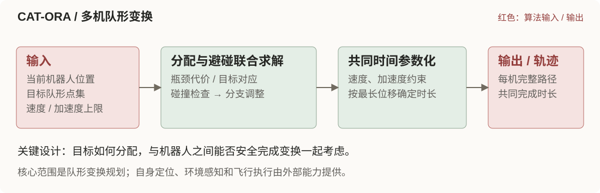
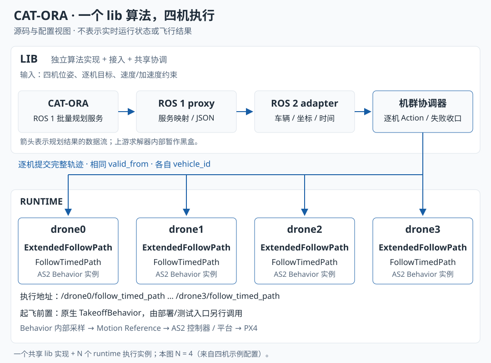

CAT-ORA 面向多机器人从一种空间队形切换到另一种队形的场景。它把“每台机器人去哪个目标点”与“变换过程中是否发生机间碰撞”放在一起求解，再按速度和加速度约束为整队生成共同完成时长的轨迹。它的特色在多机分配与运动的协调，而不是环境感知或未知障碍导航。

## 算法核心

## 在 Aerohub 中如何结合

- **Tool**：多机队形规划与调用协调，保留车辆目标归属和共同执行时间；是 Navigation Tool 的实现基础。
- **Behavior**：复用时间化路径跟随 `×4`，执行每机完整轨迹。
- **Function**：复用自身状态和运动控制 `×4`；当前展示链路未接入环境地图。

上方核心图描述算法的目标分配能力；本项目接入另有固定车辆—目标对应约束，不能将两者视为相同调用契约。三层图按四机能力关系展示，通用 Tool 尚未实现。

## 案例

<!-- 按展示约定保留案例位置，内容暂留空。 -->

## 补充信息

接入细节与验证记录

Demo 画面来自[作者公开素材](https://arxiv.org/html/2412.00603v2/fig/intro_fig.jpg)，保留未修改的本地副本，用于链接官方演示；素材来源见上方作者仓库，演示效果不计入本项目验收。

### Tool、Behavior、Function 三层接入关系

本图以项目架构的三层为固定坐标，分别标出 **CAT-ORA 提供的算法与接入、调用的执行能力、依赖的基础能力**。一个项目可以覆盖多个层；调用或依赖某层不等于实现了该层。

图示对应仓库的四机配置与 ROS 1 proxy 接入链，表达职责和接口关系。Tool 层放置的是未来 Navigation Tool 的现有实现基础；通用 Tool 接口、资源仲裁与 Mission/Agent 尚未实现。图示不是飞行记录或仿真回放。

| 架构层 | 本条目涉及的模块 | 与 CAT-ORA 的关系 |
| --- | --- | --- |
| Tool | CAT-ORA、proxy、Adapter、公共 Registry/校验与机群协调 | 提供规划与接入实现，复用框架协调；作为 Navigation Tool 的实现基础 |
| Behavior | 逐机扩展 FollowPath；外部入口先行调用 TakeoffBehavior | 调用公共执行能力；未新增 CAT-ORA 专属 Behavior |
| Function | 各机 State Estimator、Motion Controller | 直接读取现有状态，复用运动控制；未新增定位或控制算法 |
| Function 中的 Perception & Mapping | 当前展示链路未接入 | 本链未接入地图/点云，不推导上游其他配置的能力 |

### Tool：规划、适配与机群协调

四架飞机共享一次批量规划和一套机群调用协调，不为每架飞机复制整个 CAT-ORA。

| 模块 | 输入 → 输出 | 职责与实现位置 |
| --- | --- | --- |
| CAT-ORA 规划核心 | 初始构型、目标构型、速度与加速度约束 → 逐机轨迹采样点 | 上游服务 `/mrs_formation_reshaping/get_reshaping_trajectories`；源码位置 `src/planner/cat_ora/upstream/` |
| ROS 1 proxy | TCP/逐行 JSON → ROS 1 服务调用 → 轨迹数组 | `src/planner/cat_ora/ros1_proxy/ros1_proxy.py`，保留独立 ROS 1 进程与原生服务接口 |
| ROS 2 adapter | 四机位姿、目标和轨迹数组 → `TimedTrajectorySegment` | `src/planner/cat_ora/ros2_adapter/bridge/uav_cat_ora_adapter/node.py`，负责坐标、车辆归属、时间与统一消息封装 |
| 共享机群协调 | 经校验的机群轨迹段 → 每架飞机的 `FollowTimedPath.Goal` | `src/planner/framework/uav_planner_framework/follow_path_client.py`，维护 Action 接受、结果、更新、取消与机群失败收口 |

框架的 Registry、任务配置与轨迹校验也归入图中的 Tool 职责区域，共用代码保留在 `src/planner/framework/`，不复制进 CAT-ORA。这里按职责拆分，并不把这些模块描述成四个独立可替换的公共 API。

本节的接口细节以 ROS 1 proxy 接入链为例；主图仅表达能力职责。当前目录还保留 `ros2_adapter/native/` 的原生 Humble 移植实现，与统一输出适配包 `bridge/` 并列；AirSim 部署显式选择构建链，不能从 Registry 的 Noetic 镜像字段推断所有部署的运行环境。规划核心在图中作为服务黑盒，其输入输出来自代理服务字段及适配代码。

### Behavior：实际调用的基础执行能力

| 作用 | Behavior 与调用接口 | 谁调用、何时调用 |
| --- | --- | --- |
| 轨迹执行 | **扩展 FollowPath**：`ExtendedFollowPath` 继承原生 `FollowPathBehavior`；入口为 `uav_planner_interfaces/action/FollowTimedPath`，地址 `/<vehicle>/follow_timed_path` | 机群协调器在轨迹通过校验后逐机提交，接收各机结果；这是 CAT-ORA 默认执行链的 Behavior 绑定 |
| 起飞前置 | 原生 **TakeoffBehavior**：`as2_msgs/action/Takeoff`，地址 `/<vehicle>/TakeoffBehavior` | 部署/测试入口通过 `deployment/platform/fleet_takeoff.py` 单独调用；CAT-ORA adapter 不负责发起起飞 |

`FollowTimedPath` 是本仓库扩展的时间化入口，和原生 FollowPath 共处同一个扩展组件，二者互斥；它们不是前后串行调用的两个 Behavior。实现见 `src/behavior/follow_path/src/follow_path_extended.cpp`。

启动文件还加载了 Land 与 GoTo，但这不构成 CAT-ORA 调用了它们的证据，因此不列为算法调用。`legacy_setpoint` 是显式选择的旧执行链，本页图示只描述默认的 `follow_path` 后端。

Behavior 内采样时间化轨迹，再输出 Motion Reference，由 AS2 控制器与平台执行到 PX4。当前默认链路由 Behavior 承担轨迹执行。

### Function：复用的状态与控制能力

每架飞机复用现有 AS2 State Estimator 提供的位姿、速度与 TF。Adapter 直接订阅 `/<vehicle>/self_localization/pose`，转换坐标后用于规划；框架使用实际位置检查完成条件。定位插件和输入源由具体部署决定，CAT-ORA 不实现新的状态估计算法。

扩展 FollowPath 和 Motion Controller 也直接消费所需状态。Behavior 将轨迹采样为运动参考，Controller 根据参考与当前状态产生平台控制指令。状态数据无须经 Tool 转发给控制器。

图中时间化路径跟随、自身状态和运动控制均用 `×4` 聚合表示四个车辆实例，实际仍按 namespace 隔离。当前展示链路未接入 Perception & Mapping，图中以浅灰节点标注；本接入没有新增地图、点云或感知算法。PX4 与 AS2 平台适配属于更下方的平台边界，在图外注明。

### 四机如何协同

示例配置为 `src/planner/framework/examples/cat_ora_four_px4.yaml`，部署映射来自同目录的 `deployment_four_px4.yaml`。

| 车辆 | Behavior 执行实例 | Goal 坐标系 | 配置中的目标（机群 NED，米） |
| --- | --- | --- | --- |
| drone0 | `/drone0/follow_timed_path` | `drone0/odom` | `(-6, -4, -1.5)` |
| drone1 | `/drone1/follow_timed_path` | `drone1/odom` | `(-2, -4, -1.5)` |
| drone2 | `/drone2/follow_timed_path` | `drone2/odom` | `(2, -4, -1.5)` |
| drone3 | `/drone3/follow_timed_path` | `drone3/odom` | `(6, -4, -1.5)` |

这些是任务配置目标，不是测得的到达位置。`z=-1.5` 来自 NED 向下为正的约定；下发到各机 Behavior 前会转为该机本地 ENU。

统一测试脚本 `run_planner.sh` 实际会先起飞部署中的七架飞机，再选择 CAT-ORA 四机任务；图中只显示参与该规划任务的 drone0–drone3，不把部署总机数等同于算法参与机数。

多机执行的关键约束如下：

- **车辆绑定**：代理数组按任务的 `vehicles` 顺序解释；adapter 验证轨迹终点仍属于指定车辆。若上游换配违反固定“车辆 → 目标”契约，报告 `NO_SOLUTION`，不会静默换配执行。
- **共同执行时刻**：adapter 为整段轨迹设置同一个未来 `valid_from`，默认提前量为 3 秒；各机采样点保留 `time_from_start`。协调器逐机发送 Action，依靠共同时间基准执行，并不声称请求同时送达。
- **轨迹内容**：CAT-ORA 当前输出位置采样，默认间隔 0.2 秒，`valid_fields=0`；不将未声明的零速度、零加速度或 yaw 当作有效算法输出。长度较短的轨迹以自身终点补齐到共同结束时间。
- **机群收口**：某机拒绝、执行失败，或机群在共同开始时刻前未完成请求确认，协调器进入失败处理并向机群发起取消/停止；全机 Action 结果成功才满足协调器的 complete 条件。发送停止请求不等于已证明各机瞬时停止。
- **暂停语义**：时间化执行暂停后要求取消并重规划，不能在不处理共同时间基准的情况下直接续跑。

Manifest 声明 1–16 机是配置能力范围；本页四机展示不代表所有规模都已通过动力学验证。

### 核查依据与验证边界

本页依据本地源码与配置建立展示，没有启动 ROS、AS2、PX4 或重新运行 CAT-ORA。仓库主文档记载过四机无障碍 PX4/Gazebo 验收；本次未重验，也未把对应运行证据打包进 Gallery，因此页面的验证记录仍为“未登记验证证据”。这不是否定历史结果，而是限定本条目的证据范围。

| 核查内容 | 本地依据 |
| --- | --- |
| 上游来源与锁定版本 | `.gitmodules`、`src/planner/cat_ora/upstream` gitlink：`4bc41f593eebde65dd74108a97e80430a145dfa0` |
| AS2 基线 | `as2/aerostack2` 使用 AeroHub fork gitlink：`f387e0d733a5102808508bcbec1b9eca2c29d1f0`；AirSim 构建直接使用该锁定源码 |
| 服务字段与坐标/时间转换 | `ros1_proxy.py` 的 `generate()`；adapter 的 `_try_generate()`、`_message()` |
| 车辆对应、Action 名称、失败收口 | `FleetFollowPathClient` 与 `make_goal()` |
| Behavior 继承、互斥及 Motion Reference 输出 | `follow_path_extended.cpp`、`motion_behaviors.launch.py` |
| 起飞调用方及其与 Planner 的先后关系 | `deployment/platform/fleet_takeoff.py`、`deployment/integration/run_planner.sh` |
| 历史验收范围 | `docs/项目简介.md` 的 FollowPath 扩展与多机验收章节；不代表本次重跑 |

内容同步依据：[项目简介](https://github.com/Air-Suck/aerohub/blob/ca3581e6c8a1fddce4c521736e2959af81780333/docs/项目简介.md)（集成仓库版本 `ca3581e`）。后续复现平台为 AirSim + PX4 SITL；主文档的当前验收边界仍未登记 CAT-ORA 的 AirSim 多机飞行闭环。历史 Gazebo 结果不能替代该验收。以上路径用于定位源码，展示资源全部位于本条目目录。

