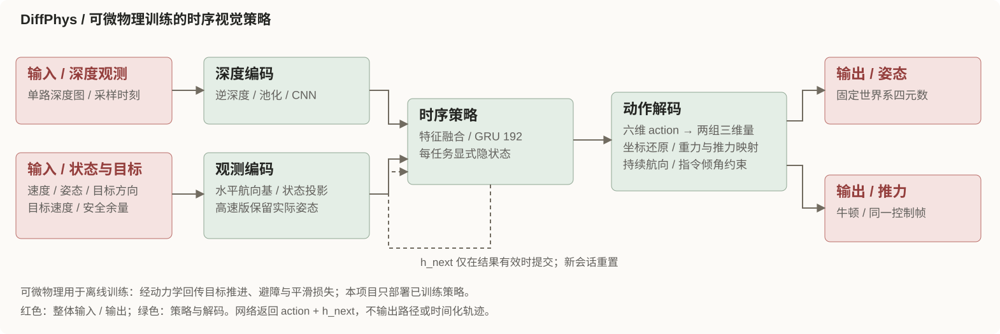
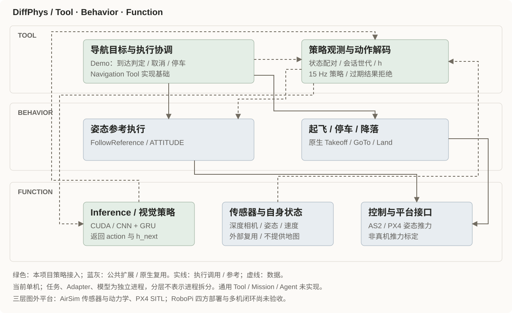

## 算法核心

可微物理是**训练方法**：上游 `main_cuda.py` 在动力学展开后累积目标速度、避障与动作平滑等损失，通过 `loss.backward()` 优化策略。当前部署只加载官方已训练权重，不运行训练。

运行时，网络接收深度与十维观测，返回六维原始 action 和 192 维隐状态。动作解码包含坐标转换、重力与悬停推力映射及航向构造；姿态与推力属于同一时间戳、同一会话的控制帧。当前采用 high-speed profile，实际姿态观测与相机裁剪均按该 profile 保留；不能套用 swarm profile 的水平姿态基约定。网络不输出路径或时间化轨迹，也不提供对外地图。

## 在 Aerohub 中如何接入

- **Tool**：Demo 组织目标、就绪检查、到达判断、取消与停车交接；策略 Adapter 配对观测，维护会话及 GRU 状态并解码动作。这些是 Navigation Tool 的实现基础，尚无通用 Tool API。
- **Behavior**：导航阶段使用公共扩展 FollowReference 的 ATTITUDE 模式；任务入口单独调用原生 Takeoff、到达后 GoTo 停车及 Land。当前链路不调用 FollowTimedPath。
- **Function**：独立 Inference worker 执行 CUDA 策略推理；复用外部相机、自身状态、AS2 控制与 PX4 平台。DiffPhys 不实现状态估计或建图。

当前为一个 `drone0`，任务、策略 Adapter 和模型 worker 独立运行，任务与算力处于同一 PC 容器拓扑；未验收工作站与 RoboPi 分离的四方部署。上游机群按各车观测独立执行策略，不依赖集中式共享规划；本项目未接入多机 Goal、共同基时间或机群失败收口，不能将上游规模视为已支持规模。

## 案例与验证边界

2026-11-11 的组件与 Demo 文档报告：high-speed 权重、目标速度 **8 m/s**、原生起飞 4 m、10 m 前视，在 AirSim + PX4 SITL 森林任务第 40 轮通过一次正常任务。路径 250.542 m，实际速度中位 6.359 m/s、峰值 8.917 m/s，终点误差 0.0462 m；随后停车、Land 与 disarmed 检查通过。

**这是一轮正常任务结果，整体复现仍未完成。** 高速相机断流未满足 10 墙钟秒恢复门槛；提高至目标速度 10 m/s 的第 41 轮发生植被碰撞。理想 DepthPlanar 与上游双目 SGM 的深度分布、控制响应及估计状态差异仍待调查。无多机、RoboPi 或真机验收。本次只做源码与文档核查、网页构建和显示检查，没有运行算法或飞行；原始第 40 轮证据包在当前工作区缺失，未独立复核，公开证据不足，元数据保持 `unverified`。

补充信息：职责证据、接口、版本与来源

### 源码职责映射

| 职责 / 层 | 输入 → 输出 | 来源文件与符号 | 调用与进程 | 实现和验收边界 |
| --- | --- | --- | --- | --- |
| 训练 / 上游离线 | 场景、动力学 → 策略权重 | `src/tool/navigation/planner/diffphys/upstream/main_cuda.py`，`loss.backward` | 上游训练进程 | 本次未训练 |
| 导航协调 / Tool | 目标 → Action、到达与交接 | `deployment/airsim/demos/diffphys_forest/mission.py`，`ActionClient` | Demo 任务进程 | 单机；通用 Tool 未实现 |
| 策略适配 / Tool | 深度、状态、会话 → 请求、ControlFrame | `src/tool/navigation/planner/diffphys/ros2_adapter/uav_diffphys_planner/node.py`，`Planner`；`core.py`，`observation` / `decode` | 独立 ROS Adapter | 15 Hz；过期或旧世代结果不推进 h |
| 模型推理 / Function | 36×48 深度、10 维状态、h → action、h_next | `src/basic_function/inference/models/diffphys/adapter.py`，`Predictor` | 独立无状态 worker | `Model(10, 6)`；high_speed 模型源码来自官方发布包，非仅 gitlink |
| 基础执行 / Behavior | ATTITUDE 会话、ControlFrame → 运动参考 | `src/behavior/follow_reference/README.md` 及森林任务入口 | 公共 FollowReference 执行节点 | 取消后交原生 GoTo；无轨迹伪装 |
| 输入与控制 / Function | 仿真深度、姿态与速度 → 观测；参考 → PX4 | `deployment/airsim/demos/diffphys_forest/README.md`、相机与平台桥 | AS2 / 平台及传感器进程 | 非 DiffPhys 自带定位、感知建图 |

### 采样与执行契约

当前单 DepthPlanar：640×480、HFOV 91°、Pitch 20°；82% 中心裁剪、nearest 48×36、逆深度归一化与 pool3。每个任务只保留一个真实未结束请求，状态与深度配对偏差 ≤50 ms、新鲜度 ≤200 ms；过期或旧会话响应不更新 GRU。求解有效期 200 ms，控制流断连保护 100 ms。姿态解码保留实际姿态第三行及持续期望航向，推力使用起飞后 PX4 悬停设定值映射，未做真机力标定。

上游训练仓库锁定 `271936190b5c2a5e760230e718fa6b167718a5bf`；部署使用官方 v1.0 发布包中的 `base.pth` 与高速模型源码，源文件和权重校验由 `src/basic_function/inference/models/diffphys/artifacts.json` 管理。swarm 与 high_speed 是不同 profile。AS2 构建复用固定镜像源码并应用仓库补丁生成 overlay，不读取本地 AS2 子模块；不能用 AS2 gitlink 代替本次部署输入。

### 阅读与核查入口

- [组件说明](https://github.com/Air-Suck/aerohub/blob/main/src/tool/navigation/planner/diffphys/README.md)
- [森林 Demo 与运行边界](https://github.com/Air-Suck/aerohub/blob/main/deployment/airsim/demos/diffphys_forest/README.md)
- [已知问题与失败记录](https://github.com/Air-Suck/aerohub/blob/main/deployment/airsim/demos/diffphys_forest/KNOWN_ISSUES.md)
- [模型接口、profile 与准备说明](https://github.com/Air-Suck/aerohub/blob/main/src/basic_function/inference/models/diffphys/README.md)

本页技术事实以当前仓库对应源码和说明为准；仓库网页链接仅为阅读入口，不作为公开运行证据。素材出处、作者归属与复用条件见本条目的 `assets/SOURCES.md`。

