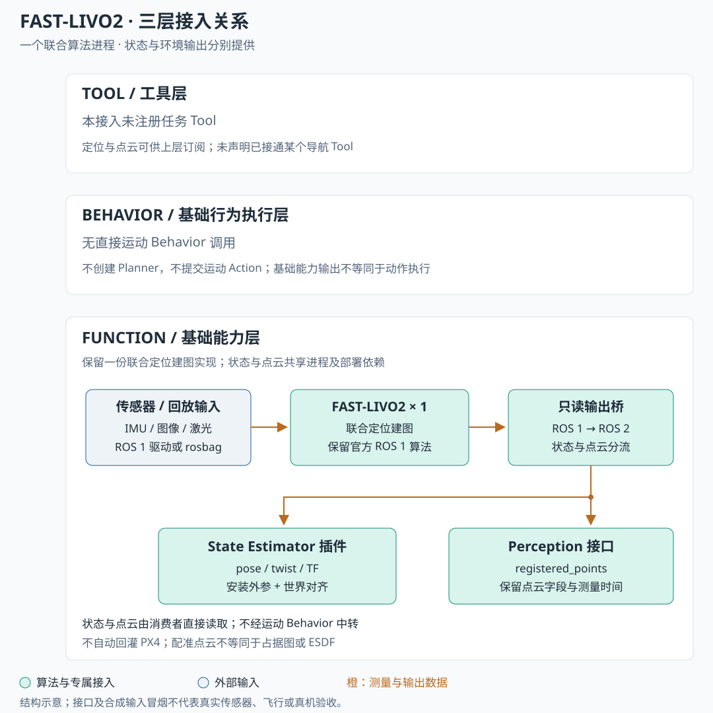

## 三层接入关系

本项目的实际覆盖集中在 **Function 层**。图中保留 Tool 与 Behavior 两层并说明未绑定，避免将输出被上层读取误写成算法已经提供了任务工具或运动执行。`×1` 表示一个联合算法实例，状态与点云两路输出共享算法和部署依赖。

| 架构层 | 实际接入 | 边界 |
| --- | --- | --- |
| Tool | 未注册任务 Tool | 数据可供上层订阅，不宣称已接入某个 Navigation Tool |
| Behavior | 无直接运动 Action 调用 | 状态发布不具有运动 Behavior 生命周期 |
| Function：State Estimator | FAST-LIVO2 输出桥与 AS2 插件 | 适配自身位姿、速度及 TF，保留统一状态接口 |
| Function：Perception | 共享桥的配准点云输出 | 保留三维点云，不自动产生占据图或 ESDF |
| Function：传感器输入 | 外部 ROS 1 驱动或回放 | 输入桥、传感器模型和标定按部署核查；不假定 AirSim 已适配 |

## Function：一个算法进程，两类能力

FAST-LIVO2 保持官方 ROS 1 Noetic 算法进程，通过只读输出桥连接 ROS 2 Humble。位姿与速度回答“自身在哪里、如何运动”，配准点云回答“周围有什么”；职责分开，不要求把联合算法拆为两个独立估计器。

| 模块 | 输入 → 输出 | 实现与消费者 |
| --- | --- | --- |
| 联合算法 | IMU、图像、所选激光消息 → 状态与配准点云 | `src/state_estimator/fast_livo2/upstream/`，保留一份算法源码 |
| 输出桥 | ROS 1 状态/点云 → ROS 2 数据 | `src/state_estimator/fast_livo2/ros1_proxy/` 与 `plugin/`；保留测量时间和点云原生字段 |
| AS2 State Estimator 插件 | 算法里程计、安装外参与世界对齐 → 自身位姿、速度、TF | `src/state_estimator/fast_livo2/plugin/`；统一输出供控制、Behavior 与上层消费者读取 |
| Perception 接口 | 配准点云 → namespaced 环境点云 | `src/perception/fast_livo2/` 描述接口，与状态接入共享算法和依赖；不是第二个独立算法进程 |

## 状态、点云接口与共享部署

本组件**无直接运动 Behavior 调用**，不创建 Planner 或运动 Behavior。状态经 `/<namespace>/self_localization/pose`、`self_localization/twist` 与 TF 提供；点云经 `/<namespace>/perception/fast_livo2/registered_points` 提供。

同一架飞机的主状态与 TF 应有明确发布权；示例不自动替换多机现有定位源。AS2 消费 FAST-LIVO2 状态，不代表 PX4 已融合外部定位。配准点云也不等于占据图、ESDF 或可直接消费的完整导航地图。

状态与环境接口共用算法、ROS 1 master 及输出桥；仅停止某一路消费者不等于停止算法，重置算法时需处理两路消费者的局部世界变化。核查依据为 `src/state_estimator/fast_livo2/README.md`、`plugin/src/plugin.cpp`、`plugin/scripts/bridge.py` 以及 `src/perception/fast_livo2/README.md`。图中没有把它们拆成两个可独立启停的估计器。

## 已验证范围与接入缺口

主文档记载 Docker 编译、两套 AS2 宿主插件契约，以及合成 IMU/激光/图像端到端冒烟通过。真实数据集、PX4 融合和飞行验收仍未完成。合成输入只验证算法与接口链，不能推导出真实定位精度。

AirSim 桥现有 XYZ-only 点云与 FAST-LIVO2 预处理所需的逐点时间等字段尚有语义缺口；ROS 2 原始传感器到 ROS 1 算法的输入桥、时钟与标定也需另行接入。现有只读输出桥不覆盖该输入方向。

本次仅同步网页，没有接入传感器或运行算法。尚未整理公开运行证据，页面验证记录保留“未登记验证证据”。

内容来源：[项目简介](https://github.com/Air-Suck/aerohub/blob/ca3581e6c8a1fddce4c521736e2959af81780333/docs/项目简介.md)，同步版本 `ca3581e`。源码目录用于定位实现，不由网页构建直接加载。
