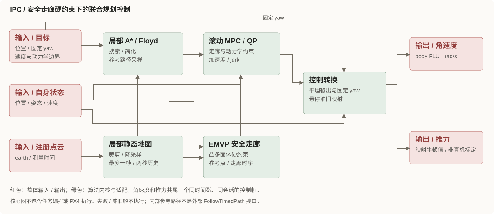
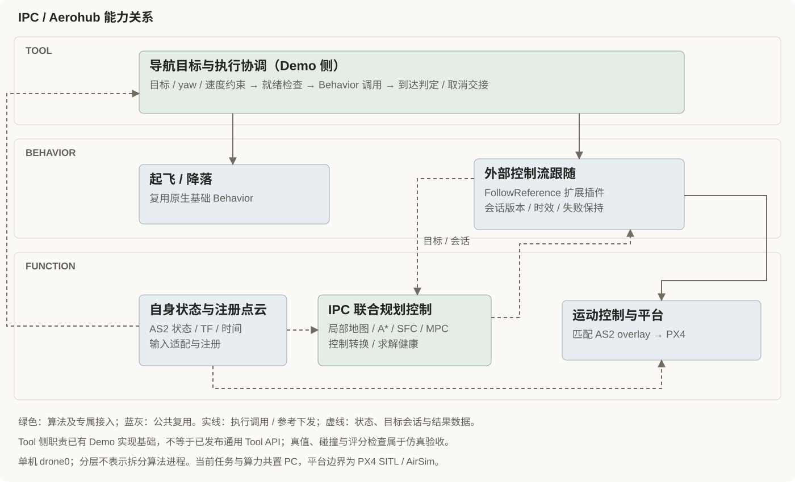

**当前验证范围：单机 PC 静态森林，未覆盖上游演示的突发障碍与扰动。**

## 算法核心

安全走廊作为 QP 硬约束，不以只检测路径碰撞替代。路径重规划与高频 MPC 分开调度；当前地图每次更新后复查剩余路径，MPC 始终使用当前地图构建走廊。项目保留上游算法内核，但存在明确适配差异，详见补充信息。

## 在 Aerohub 中如何接入

- **Tool**：已有导航目标与执行协调的实现基础：Demo 侧组织目标、yaw 和速度约束，检查就绪，调用 Behavior，判定到达并协调取消、停止与降落；尚未封装为通用 Tool API，不代表 Mission / Agent 已实现。
- **Behavior**：复用 FollowReference 的 external_acro 插件管理执行会话、控制时效、取消与保持；起降另行调用原生 Behavior。
- **Function**：IPC 负责局部地图、路径、安全走廊、MPC 和控制转换，复用 AS2 状态、注册点云与控制器 / 平台。

当前是一台 `drone0`，无多机同步或共享规划声明。同一个接入同时涉及 Tool 侧协调、Behavior 执行与 Function 求解，不能因通用 Tool 未发布而把 Tool 层留空。联合内核保留在 Function，不强拆进程；它不是 FollowTimedPath 后端，也不是把求解器装进 Behavior。

## 案例

<!-- 暂留空；历史结果与官方演示分别在补充信息和顶部交代。 -->

## 补充信息

实现、部署与验证范围

Demo 封面来自[作者 README 原图](https://raw.githubusercontent.com/hku-mars/IPC/0f959ca7995e71a1fcc4942bd4a86869ab6ee975/IPC/img/out.png)，原始尺寸 4400×2475（约 5.5 MiB）；本地副本仅等比例缩至 1280×720 并转 JPEG，保留作者、平台与标题，不更改画面含义。无单独素材许可声明，不宣称可自由再授权。点击封面进入官方视频，非 Aerohub 实测录像。

### 源码与实际接口

上游锁定 `0f959ca7995e71a1fcc4942bd4a86869ab6ee975`，本地子模块未检出。本次核查本仓库 native 实现，以及 `upstream-manifest.json` 的导入哈希和适配映射；通过官方锁定版本 README 核对名称、作者演示与论文入口，不自动构建或运行。

| 模块 / 职责层 | 输入 → 输出 | 源码 / 符号 |
| --- | --- | --- |
| 导航目标与执行协调 / Tool 实现基础 | 任务目标、yaw、速度与就绪状态 → FollowReference Goal；到达后取消并检查停止、降落交接 | `deployment/airsim/demos/ipc_navigation/forest_mission.py`：`Mission.run`；目前在 Demo 任务进程，非独立 Tool 服务 |
| 局部搜索与参考 / Function | 自身状态、目标、静态点云 → A*/Floyd 路径和参考点 | `native/core/engine.hpp`：`Engine::plan`；`core/local_astar.cpp` |
| 安全走廊 / MPC / Function | 参考、状态与障碍 → 加速度、jerk | `Engine::GenerateAPolytope`、`Engine::solve`；`core/mpc.cpp` |
| 控制转换与输入门 / Function | earth 状态 / fixed yaw / 成功解 → body FLU 角速度和推力 | `native/src/node.cpp`；解算失败、旧会话或陈旧解拒绝 |
| 执行会话 / Behavior | FollowReference Goal → ControlSession；ControlFrame → Motion Reference | `src/behavior/follow_reference/` 的 external_acro 插件 |

`native/` 位于 `src/planner/ipc/ros2_adapter/`。主要接口为 `/drone0/navigation/odom`、`navigation/points`、`external_acro/session` 与 `external_acro/control`；`ipc/path` 仅供观察，不是外部时间化轨迹执行接口。点云已注册到 earth；里程计速度为 body FLU，算法用姿态转换。推力字段通过接管前测得的悬停油门与 AS2 max_thrust 映射，不代表真机力标定。

### 三层职责与进程证据

Tool 侧不是新增的虚构服务：`forest_mission.py` 的 `Mission.run()` 在起飞和就绪检查后，转换地面相对目标、计算固定 yaw、填写速度上限并提交 FollowReference Goal；循环检查到达与速度保持，取消 Goal 后确认物理停止，再处理降落。执行复用插件；算法仍在独立 native 节点，不在任务客户端里求解。

同一个 Demo 还包含 AirSim 真值、碰撞与评分门，本次在图中只标出已有的目标/调用/交接职责，不能把该验证客户端说成已经解耦的生产 Tool。尤其当前到达与停止门同时检查估计值和真值；真值是仿真验收依赖，通用导航完成判定尚待抽离，不宣称可原样用于真实部署。源码注释中的“任务角色”、目录归类与能力层级不是同一概念。

### 生命周期、部署与适配差异

会话包含 ID、revision、目标、固定 yaw 和逐轴速度上限；仅成功新求解可输出有效控制。独立发送线程重复发送时保留原计算时间和最后成功求解时间，不续期旧解。状态 / 新扫描 / 控制有效期分别为 200 / 500 / 100 ms，并另查墙钟；频繁发送不能替代求解或 PX4 消费频率。

FollowReference 连续跟随不自动判到点；任务协调判定位置、速度与持续时间，随后取消，确认物理停止，再原生 Land 并确认解除武装。暂停后不能恢复旧流，需取消并提交新目标。样例协调运动互斥，不等于通用跨 Behavior 资源仲裁已实现。

适配保留最多十帧 / 两秒局部静态点云历史，未迁移在线推力辨识或 RC 接管。原走廊时序 QP 不可行时，仅在当前认证凸走廊内保留全部动力学约束重新求解，成功新解才执行；不是执行失败解或软化障碍。上游根目录无统一许可证，几何源文件保留各自原许可，本页不重新授权代码或作者素材。

当前 IPC、输入适配、FollowReference 与 AS2 在 PC 算力侧；任务另进程但共置 PC 容器。仿真与飞控分别为 AirSimNH 和 PX4 SITL。高频控制不经任务脚本转发，未证明 RoboPi 部署。复用固定共享镜像并显式加载控制器 / 平台修复及匹配消息 overlay，不因 Gallery 整理重建镜像。

### 文档报告的验证范围

2026-11-10 的 `super-3mps-balanced-01/02` 使用一致产物、配置与预声明标准，两次全新启动完成自由 XYZ 静态森林任务。版本化摘要和 Demo 文档报告：

| 指标 | 首轮 | 独立复跑 |
| --- | ---: | ---: |
| 实际航迹 | 237.63 m | 238.99 m |
| 仿真导航用时 | 82.87 s | 84.79 s |
| 实际速度中位数 | 2.976 m/s | 2.979 m/s |
| 全航迹平均速度 | 2.868 m/s | 2.818 m/s |
| 真值终点误差 | 0.109 m | 0.126 m |
| 最小原始点云距离 | 0.968 m | 0.890 m |
| 新成功求解平均频率 | 99.854 Hz | 99.666 Hz |

两轮报告导航无新增碰撞，取消后物理停止、原生降落、解除武装与自有资源清理通过。名义巡航 3 m/s、参考 3.6 m/s 与实际速度分开；不是整段恒速。平均约 100 Hz 求解不证明硬 10 ms 期限或固件逐周期 100 Hz 消费。

约 192 ms 点云年龄是最新扫描相对原始采样时间的年龄，不是 IPC 计算耗时；动态障碍需单独计入发现—规划—制动预算。旧 20 m 定高结果仅作历史，不能替代当前自由 XYZ 任务。指定墙障碍上绕 / 下绕只有几何回归，未证明其物理闭环。

本次仅整理展示，未重跑算法。版本化 JSON 摘要可读，但本地缺少原始运行证据包，公开可核查证据尚未随 Gallery 登记，故元数据保留 `unverified`；不扩大为 RoboPi、真机、多机、突发 / 动态障碍或扰动验收。

### 文档入口

- [native 实现说明](https://github.com/Air-Suck/aerohub/blob/main/src/planner/ipc/ros2_adapter/native/README.md)
- [组件验证与失败历史](https://github.com/Air-Suck/aerohub/blob/main/src/planner/ipc/validation.md)
- [自由 XYZ Demo 与验收摘要](https://github.com/Air-Suck/aerohub/blob/main/deployment/airsim/demos/ipc_navigation/README.md)
- [固定摘要文件](https://github.com/Air-Suck/aerohub/blob/main/deployment/airsim/demos/ipc_navigation/validation-free-xyz-20261110.json)
- [官方锁定版本 README](https://github.com/hku-mars/IPC/blob/0f959ca7995e71a1fcc4942bd4a86869ab6ee975/README.md)

本页同步 2026-11-12 本地工作区，main 链接用于文档定位，不作为不可变证据版本。

