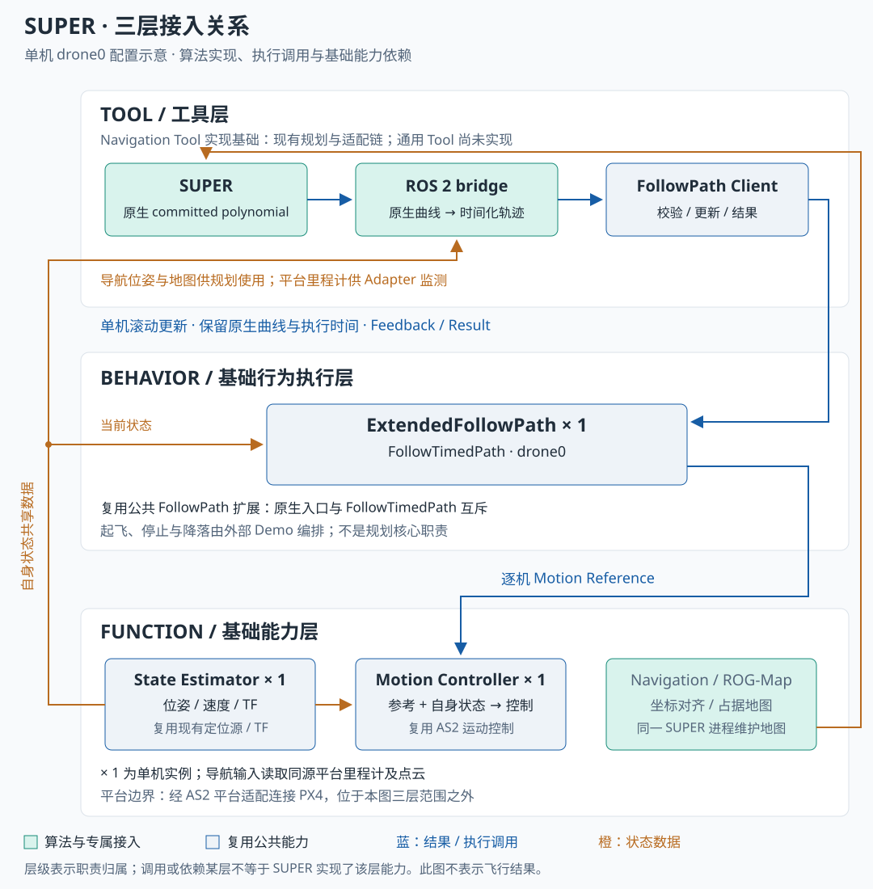

## 在 Aerohub 中如何接入

- **Tool**：SUPER 生成路径，Adapter 转换原生多项式，并协调滚动执行；这是 Navigation Tool 的实现基础。
- **Behavior**：复用扩展 FollowPath 执行单机时间化轨迹，处理反馈、结果和取消。
- **Function**：接入导航输入与 ROG-Map，复用现有定位和运动控制；ROG-Map 与规划在同一 SUPER 进程内。

架构图按单机 `drone0` 展示当前接入关系，不是飞行回放。通用 Tool 与目标四方部署仍有待完成。

[Bilibili 备用观看入口](https://www.bilibili.com/video/BV1BSFgeJEJn/)

接入细节与验证记录

Demo 封面来自[作者官方视频的公开封面](https://i.ytimg.com/vi/GPHuzG0ANmI/maxresdefault.jpg)，以未修改的本地副本随站点发布，用于链接作者原演示；来源和原演示链接保留在页面中。

### 三层职责与源码

| 架构层 | 涉及的能力 | 实现或依赖关系 |
| --- | --- | --- |
| Tool | SUPER 规划、ROS 2 bridge、公共 FollowPath Client | 原生曲线适配和执行协调，构成 Navigation Tool 实现基础 |
| Behavior | 扩展 FollowPath | 复用公共执行能力；Demo 另行编排起飞、停止与降落 |
| Function | 导航输入适配、ROG-Map | 已接入点云/里程计对齐及算法自带环境表示，ROG-Map 与 SUPER 规划同进程 |
| Function | State Estimator、Motion Controller | 复用平台现有状态与 AS2 控制，没有新建定位算法 |

### Tool：原生规划与时间化适配

| 模块 | 输入 → 输出 | 实现与职责 |
| --- | --- | --- |
| 导航输入 | 位姿、点云 → 规划所需导航输入 | `src/perception/navigation_inputs/`；环境输入与自身定位职责分开 |
| 原生 SUPER | 导航输入、目标 → 已提交的多项式轨迹 | 当前构建使用主仓库 `src/planner/super/ros2_adapter/native/`；`upstream/` 保留为参考，来源记录见 native 内的 `SOURCE.json` |
| ROS 2 bridge | committed polynomial → `TimedTrajectorySegment` → Action 调用 | `src/planner/super/ros2_adapter/bridge/uav_super_adapter/node.py`；保留原生曲线与执行时间，借助公共 `FleetFollowPathClient` 管理滚动更新 |

接入时参考的派生仓库为 [Popc0rn7/SUPER-sim](https://github.com/Popc0rn7/SUPER-sim)，作者官方演示来自 `hku-mars/SUPER`。此页记录的实现版本以集成仓库 `ca3581e` 为依据，不能用参考子模块的版本替代实际 native 构建来源。当前展示为单机 `drone0`，不推导出多机规划或同步能力。

### Behavior：扩展 FollowPath

Adapter 通过 `/<vehicle>/follow_timed_path` 调用 `uav_planner_interfaces/action/FollowTimedPath`，由扩展 FollowPath 在 Behavior 内采样，再进入 Motion Reference → AS2 控制器/平台 → PX4。轨迹包含位置、速度与加速度，原生多项式用于核对执行参考。

起飞、目标下发、到点保持、停止确认和降落解除解锁由 Demo 任务编排负责，不能把这些职责写成 SUPER 求解器自身的能力。滚动更新须等待初始执行参考，Action 接受不等于已经产生运动参考。

### Function：导航输入与 ROG-Map

`as2_navigation_inputs` 是独立 ROS 2 节点，将平台 Odometry 和传感器点云变换到统一局部世界系，输出 `/<vehicle>/navigation/odom`、`navigation/points`。该节点保留输入时间，并按点云时刻查询 TF，不发布自身 TF，也不把同源平台里程计自动升级为融合定位。

SUPER 内部 ROG-Map 消费对齐点云和对应时刻的 TF，维护环境占据表示，供规划使用。规划与地图使用同一局部参考系；图中橙色线表示数据依赖，ROG-Map 是同一个 SUPER 进程的组成部分。图中“Navigation / ROG-Map”聚合的是这两项相关职责，不表示导航输入节点也运行在 SUPER 进程中。

AS2 State Estimator 继续提供现有状态及 TF，Motion Controller 直接消费参考与自身状态。Adapter 还读取 `sensor_measurements/odom` 监测位姿时效。传感器、TF 与时钟是启动依赖；仿真时间回退不能直接沿用旧地图。平台边界仍为 AS2 平台适配与 PX4。

核查入口：`src/perception/navigation_inputs/README.md`、native 中的 `super_planner/AS2_INPUTS.md` 与 `config/as2_inputs_ros2.yaml`，以及 bridge 中 `SuperAdapter` 的订阅与公共 Client 调用。这里描述接入关系，不扩大已有地图精度或飞行验收结论。

### 四方部署目标与历史拓扑

目标为工作站经 ROS 调用就绪的 RoboPi 能力；SUPER、Adapter 和 AS2 执行链在算力板，高频控制由板内产生与消费。AirSim 提供环境与模拟传感器，PX4 SITL 对应飞控板。工作站负责交互、任务编排及仿真验收。

历史 `robopi-all` 把 `mission.py` 也放在 RoboPi，脚本同时启动算法、编排任务和查询碰撞真值。它尚未按目标边界拆分，不能据此宣称通用 Mission/Tool 或目标四方拓扑已经完成。

### 已记录的短程结果

2026-11-09 主文档记录一次独立 4 米短程仿真闭环：真实 SUPER 规划、板端滚动更新与执行、停止确认、降落解除解锁。到点误差约 0.205 米，执行至 revision 28，144 条运动参考均找到原生曲线候选。

该结果只适用于当次短程用例，不替代 forest8 长任务、异常恢复、长期可靠性或真机验收；时钟持续同步可靠性仍未确认。本次没有重新运行仿真。页面保留主文档对历史结果的描述，原始运行证据未在此整理为公开证据，验证记录仍为“未登记验证证据”。

内容来源：[项目简介](https://github.com/Air-Suck/aerohub/blob/ca3581e6c8a1fddce4c521736e2959af81780333/docs/项目简介.md)，同步版本 `ca3581e`。源码目录用于定位实现，不由网页构建直接加载。

