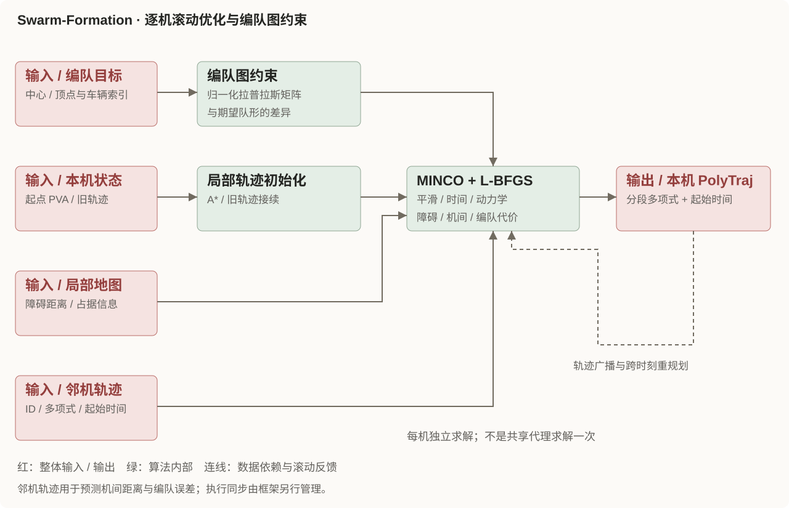
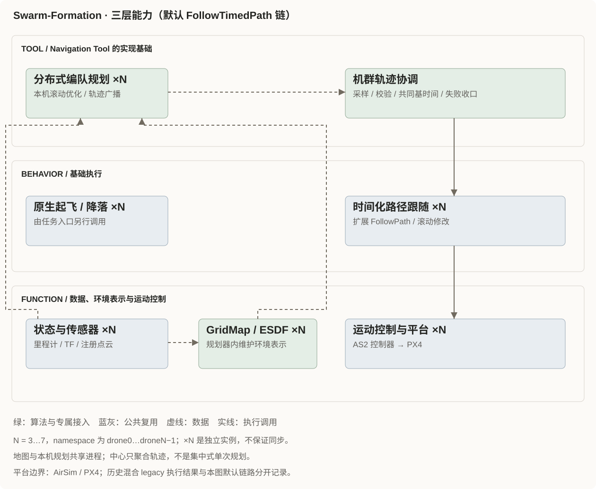

## 算法核心

编队约束使用归一化拉普拉斯矩阵与期望图的差异，机间避碰则按邻机轨迹预测位置计算，两者不是同一个代价。图中滚动反馈代表跨时刻重规划，不能视为多机执行已天然同步。

## 在 Aerohub 中如何接入

- **Tool**：逐机编队规划与公共协调构成 Navigation Tool 的实现基础，通用 Tool / Mission 尚未实现。
- **Behavior**：默认复用扩展 FollowPath 的时间化路径跟随；起降由任务入口另行调用原生 Behavior。
- **Function**：复用逐机状态、传感器和控制，算法内维护各机 GridMap / ESDF；地图与本机规划可共享进程。

当前原生入口支持 `N=3…7`，每机独立规划、独立 namespace。一个 UAV 计算节点在 RoboPi，其余分别由 PC 独立线程监管独立容器；PC 工作站调用任务。角色、机数和执行后端的验收须分别核对。

## 案例

<!-- 暂留空，不将作者 Demo 或历史结构图改称本项目案例。 -->

## 补充信息

实现、部署与验证范围

### 来源与算法核查

上游锁定 `967a4bdfae949e994691f8ffc87dbb0147cbebb7`，本工作区子模块未检出；本次核查本仓库的 Humble native 移植，不自动拉取或运行算法。Demo 沿用作者 README 中的[原始封面](https://raw.githubusercontent.com/ZJU-FAST-Lab/Swarm-Formation/main/fig/post.jpg)，不代表 Aerohub 实测；上游 GPLv3 与素材来源保留，不另外声称封面具备宽松授权。

| 模块 / 职责 | 输入 → 输出 | 本次核查位置 |
| --- | --- | --- |
| 编队图 | 邻机位置与目标图 → 图差异 / 梯度 | `native/swarm_graph/src/swarm_graph.cpp`：`calcMatrices`、`calcFNorm2` |
| 逐机优化 | 初始化轨迹、地图、邻机轨迹 → 本机 PolyTraj | `native/plan_manage/src/planner_manager.cpp`：`reboundReplan`；`native/traj_opt/src/poly_traj_optimizer.cpp`：`costFunctionCallback`、`swarmGraphGradCostP` |
| 输入与地图 | 注册点云、body twist 里程计 → 共享 ENU / GridMap / ESDF | `native/plan_manage/launch/seven_planners.launch.py`；`native/plan_env/` |
| 聚合与执行 | 各机 PolyTraj → 采样 PVA → 公共协调 / 执行 | `native/plan_manage/scripts/ros2_proxy.py`、`ros2_adapter/bridge/`、公共 `follow_path_client.py` |

表中 `native/` 位于 `src/tool/navigation/planner/swarm_formation/ros2_adapter/`。地图输入从当前 AirSim LiDAR 经真实 TF 注册接入，不再只描述历史 `obs_num=0` 仿真地图。旧 ROS 1 七机代理链仍保留，但不是当前 Humble 进程边界。

### 车辆、时间与部署差异

当前 native launch、编队图与 adapter 接受连续编号的 3…7 机，目标按原生六边形顶点前 N 项与 scale 映射；没有任意队形自动重排。真实模式显式使用消息高度，公共 `formation_scale` 必须与原生 `swarm_scale` 一致。逐机里程计与地图注册到共享 ENU，保留采样时间、body twist 及多项式的 duration / start_time；历史 ROS 1 代理的 NED 转换不能套到此 native 链。

公共 FollowTimedPath 链保留 PVA、共同 valid_from、滚动确认和失败收口；不以仅发送终点替代完整轨迹。暂停后取消重规划，不续用旧执行基准。起飞在导航前另行调用。

**默认链路和历史混合验收必须分开**：纯 PC `run.py` 显式选择 `follow_path`；混合 worker 的缺省仍为 `legacy_setpoint`，板端入口只启动 takeoff/land，并通过专用输出 adapter 执行 FleetSetpoint。三机/五机混合结果不能当作 FollowTimedPath 后端在这些拓扑上通过。页面主图表示默认目标执行链，不将 legacy 画成其已验证替身。

当前混合入口说明明确任务客户端在 PC ground 容器、中心 proxy 可在板端或 PC；文档后段旧的“Planner 在 RoboPi”描述属于早期固定三机拓扑，不能覆盖当前角色归属。分布式算法广播与集中式输出汇总分开理解。

### 历史验证报告与未覆盖项

| 范围 | 组件 / Demo 文档报告 | 限定 |
| --- | --- | --- |
| 七机 Humble | 固定输入数值回归与合成里程计滚动回放通过 | 不是七机 AirSim 动力学飞行 |
| 2026-11-06 三机 PC/RoboPi | SUCCEEDED，降落解除武装；最小真值间距 2.746 m，最大终点误差 0.524 m | 111 段；一条广播因 269 ms 起始时间差被拒收，不宣称零通信问题 |
| 2026-11-11 三机角色矩阵 | board_center / board_worker 完整飞行；worker planner 和 PC center proxy 故障均 FAILED 后 HOVER、降落 | 进程故障不等于整机 / 容器失联覆盖 |
| 2026-11-11 五机 | board_center 飞行通过，五机降落解除武装，最小真值间距 3.02 m | 按索引映射原生顶点，不是自动队形重排或七机通过 |

默认 `swarm_clearance=0.5` 不满足应用 2 m 门限的失败记录仍保留；后续显式配置 2.0，并未降低验收门槛。Gazebo 历史结果只作追溯，不替代 AirSim 验收。

本次只整理页面，未启动 ROS、RoboPi 或仿真。以上为源文档报告；本工作区缺少其 `log/swarm-infra/` 与历史原始证据包，未独立复核，元数据保留 `unverified`。不据此扩展为七机混合飞行、长期稳定、真机或所有复杂障碍场景通过。

### 文档入口

- [组件说明](https://github.com/Air-Suck/aerohub/blob/main/src/tool/navigation/planner/swarm_formation/README.md)
- [混合部署与角色矩阵](https://github.com/Air-Suck/aerohub/blob/main/deployment/airsim/demos/swarm_open_field/README.md)
- [共享机群配置](https://github.com/Air-Suck/aerohub/blob/main/deployment/swarm/configs/swarm_open_field.yaml)

同步依据为 2026-11-12 本地工作区；main 链接仅供定位，不作为不可变公开验收证据。

