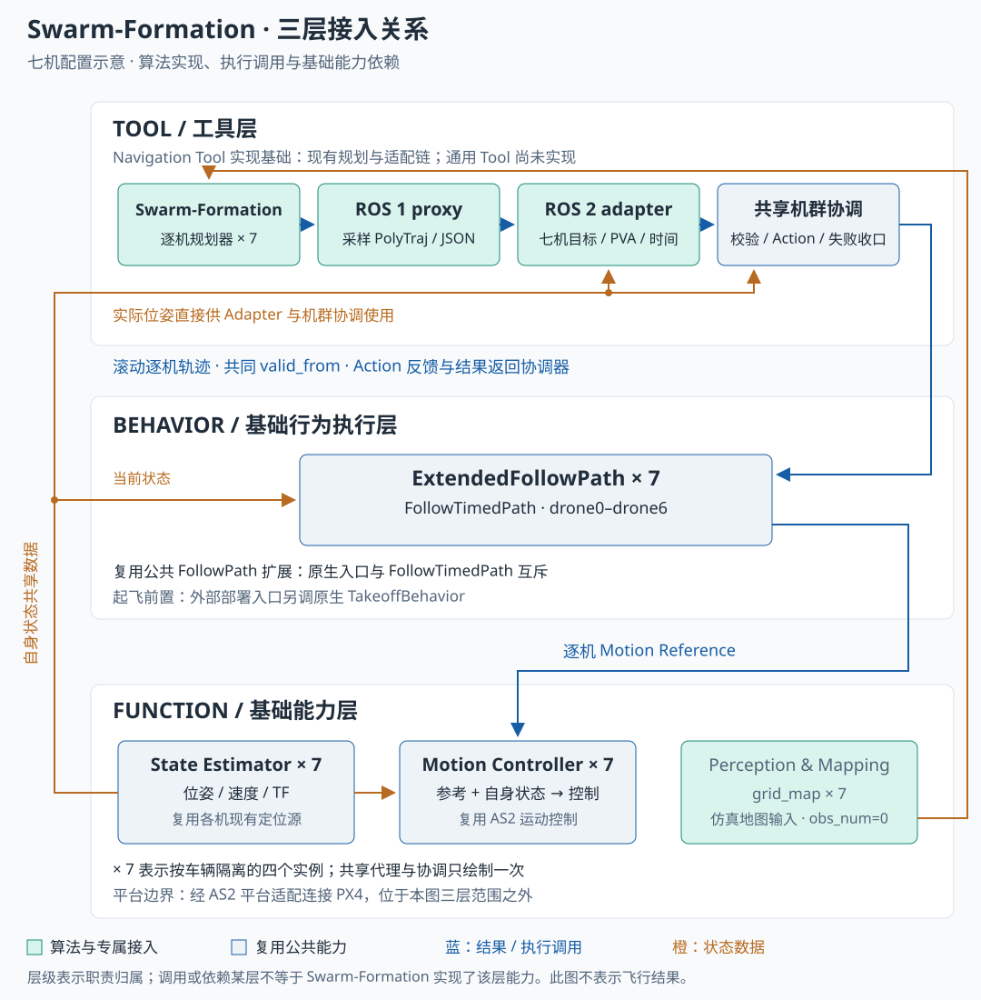

## 七机滚动规划

Swarm-Formation 持续生成短时轨迹窗口。与 CAT-ORA 一次生成有限轨迹不同，它需要在执行中更新路径，并保持轨迹覆盖和首点连续性。公共 Registry 当前固定七机，不支持通过任务 YAML 任意重定义队形偏移。

## 三层接入关系

图示对应公共 Registry 的 **ROS 1 七机接入配置**。七个原生规划实例协作、广播轨迹，一个共享代理与 ROS 2 Adapter 聚合输出，公共协调器再逐机调用执行。绿色表示算法及其接入，蓝灰表示复用能力；图示不代表通用 Tool 已完成，也不是实际飞行回放。

| 架构层 | 涉及的能力 | 实现或依赖关系 |
| --- | --- | --- |
| Tool | 原生逐机规划器 `×7`、共享 proxy、Adapter、机群调用协调 | 算法与接入构成 Navigation Tool 实现基础；共享代理不等于集中式单次规划 |
| Behavior | 扩展 FollowPath `×7` | 调用公共执行扩展；Takeoff 由外部部署入口先行调用 |
| Function | State Estimator `×7`、Motion Controller `×7` | 复用现有逐机定位与控制，不新增对应算法 |
| Function | 上游 `grid_map ×7` 与仿真地图输入 | 原生规划器内维护环境表示；历史地图配置 `obs_num=0`，不证明真实传感器感知已接入 |

`×7` 聚合表示 `drone0` 至 `drone6` 的独立实例；图中的共享 proxy、Adapter 和机群协调均只画一次。

## Tool：规划、适配与共享协调

| 模块 | 输入 → 输出 | 实现与职责 |
| --- | --- | --- |
| 上游算法与 ROS 1 proxy | 七机状态、编队中心 → `PolyTraj` 采样 | `src/planner/swarm_formation/upstream/` 与 `ros1_proxy/ros1_proxy.py`；TCP/JSON 代理保留原算法进程 |
| ROS 2 adapter | 逐机目标、状态、轨迹采样 → `TimedTrajectorySegment` | `src/planner/swarm_formation/ros2_adapter/bridge/uav_swarm_formation_adapter/node.py`；校验七机偏移，保留位置、速度和加速度 |
| 公共执行协调 | 完整机群轨迹 → 逐机 Action 与滚动更新 | `src/planner/framework/uav_planner_framework/follow_path_client.py`；校验、共同执行时间、更新确认和失败收口 |

`ros2_adapter/native/` 另有 Humble 移植代码。主文档区分原生 Humble 与 ROS 1 代理部署；上表描述统一框架的代理接入链，不表示每种部署都运行 ROS 1。

## Behavior：七个执行实例

`drone0` 至 `drone6` 各有扩展 FollowPath 实例，通过 `/<vehicle>/follow_timed_path` 接收 `uav_planner_interfaces/action/FollowTimedPath`。一个机群任务共用协调逻辑，逐机发送请求，使用同一执行基时间；逐机调用本身不保证同步。

扩展组件继承原生 `FollowPathBehavior`，保留原入口并与时间化入口互斥。Behavior 内部采样后，经 Motion Reference、AS2 控制器和平台送达 PX4。原生 TakeoffBehavior 由部署/测试入口先行调用。

- 轨迹使用共享 NED，执行前按逐机原点转换到本地 ENU；原点和 namespace 来自部署配置。
- 默认提前量为 0.5 秒，保留多项式的速度与加速度，不提供算法 yaw。
- 发布前检查完整机群和首点与实际位置的距离，默认阈值为 1.5 米。
- 全部终点进入指定目标 0.1 米内且末两点距离不超过 0.01 米时，将原窗口标记 final 并停止发布；最终完成仍由执行结果及实际位置判定。
- 滚动轨迹断流、更新失败或任一机执行失败需机群收口。暂停后取消并重规划，不能直接续跑旧时间基准。

## Function：自身状态、控制与环境表示

Adapter 从各机 `self_localization/pose` 读取实际位姿，转换到共享坐标后交给代理；代理为七个原生规划器发布 Odometry，并接收各机 `PolyTraj` 与广播轨迹。逐机规划关系可核查 `deployment/swarm_formation_ros1/four_planner.launch`，虽然文件名沿用 four，内容实际启动编号 0–6 的七个规划实例。

同一启动文件还启动仿真地图生成器。`upstream-integration.patch` 将逐机 `grid_map/cloud` 接到 `/map_generator/global_cloud`，地图由规划进程内的 `grid_map` 维护；图中跨层连线表达环境数据依赖，不要求将地图模块拆成独立进程。当前历史配置障碍物数量为零，不能把这条链路写成已验证的真实点云感知或物理一致避障。

Behavior 与 Motion Controller 直接使用所需状态，运动参考在 Behavior 内产生。定位、控制实例与各机 namespace 对应，平台仍通过 AS2 适配连接 PX4；选择原生 Humble 或其他部署时应重新核查地图与输入链，不能直接套用本图。

## 历史结果与当前边界

主文档记录七机 PX4/Gazebo 历史验收。目录重组后首轮在 43 段后因 drone2 首点距实际位置 1.825 米而拒绝；独立运行目录复测以 286 段成功。该复测不证明首轮根因已被永久修复，校验阈值没有放宽。

后续复现统一使用 AirSim + PX4 SITL。已有构建、适配回归及采样测试不能替代 Swarm 的 AirSim 多机动力学闭环。本次只同步展示内容，没有启动算法或仿真；未随页面整理公开运行证据，因此验证记录保留“未登记验证证据”。

内容来源：[项目简介](https://github.com/Air-Suck/aerohub/blob/ca3581e6c8a1fddce4c521736e2959af81780333/docs/项目简介.md)，同步版本 `ca3581e`。源码目录用于定位实现，不由网页构建直接加载。
