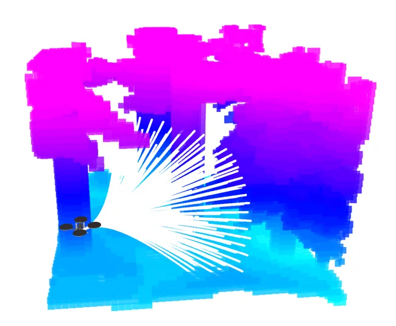
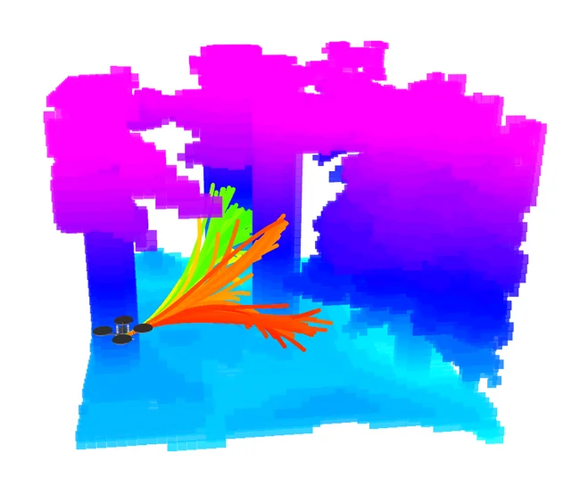
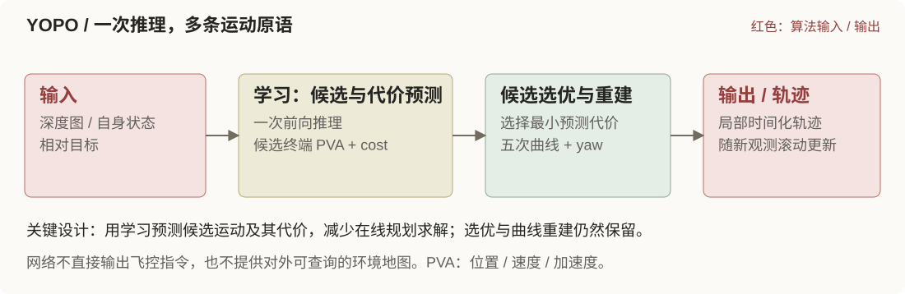
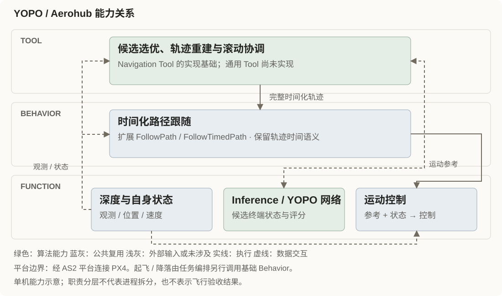

## 算法核心

<figure class="method-card">

<figcaption><h3>运动原语：覆盖多个方向</h3>
预设运动原语作为候选锚点，覆盖前方搜索空间，为不同绕障方向保留选择。
</figcaption>
</figure>
<figure class="method-card">

<figcaption><h3>候选预测：选优后重建</h3>
网络预测候选终端状态与代价；后续选取低代价候选并重建轨迹，彩色候选不会全部执行。
</figcaption>
</figure>

## 在 Aerohub 中如何结合

- **Tool**：选择候选、重建轨迹并协调滚动更新；是 Navigation Tool 的实现基础。
- **Behavior**：复用时间化路径跟随；起飞与降落另行调用原生基础 Behavior。
- **Function**：YOPO 网络通过 Inference 提供候选预测；复用深度、自身状态和运动控制，不新增对外地图。

单机 `drone0` 的规划、推理与执行由算力侧提供，工作站下达任务目标。通用 Tool / Mission / Agent 尚未实现。

## 案例

<!-- 按展示约定保留案例位置，内容暂留空。 -->

## 补充信息

实现、部署与验证范围

### 输入、输出与进程边界

| 模块 / 层 | 输入 → 输出 | 实现与职责 |
| --- | --- | --- |
| YOPO Planner / Tool | 深度、定位、目标、候选 → 时间化轨迹 | `src/tool/navigation/planner/yopo/ros2_adapter/`；选优、ENU 变换、五次重建、20 ms yaw 计划与确认后的时间线 |
| Inference / Function | 视轴深度、对齐系速度/加速度/相对目标 → 全部候选及 cost | `src/basic_function/inference/models/yopo/`；ROS Adapter → 内部 FastAPI → 独立模型 worker，不维护任务目标、不生成控制量 |
| FollowTimedPath / Behavior | 时间化 PVA/yaw → Motion Reference | `src/behavior/follow_path/` 公共扩展；首段 Action，后续 modify，保留连续性校验、反馈与停止 |
| 状态、相机与控制 / Function | 定位/TF/深度 → 规划输入；运动参考 → 平台控制 | 复用 AS2 和平台输入；相机几何须独立核验，网络隐式处理环境不等于输出地图 |

算法源码仍归 `src/tool/navigation/planner/yopo/upstream/`，锁定官方 YOPO-Simple 提交 `bd8a7f91953cfef9f1aa9a48d7ff0ab7bceee132`，不是 YOPO-MINCO 分支。模型环境为 Python 3.8、PyTorch 2.4.1 + cu118；权重为 `epoch50.pth`，SHA256 `09ec31094ed83e09702efc1facf18076564ebbe1afc164960c41036e16ba229f`。模型和 Planner 不共享 Python 环境，Planner 不导入 PyTorch。

### 时间、坐标与执行

采用上游已有的 `plan_from_reference=True`，不宣称与原 Demo 默认 measured 模式等价。图像采集时间与未来规划参考时间分别保留；相机对齐系中的候选转换到车辆固定 ENU，单机客户端避免机群客户端的重复 NED → ENU 转换。

默认交接为 now + 0.2 s，推理超时 0.1 s，发送至少预留 0.05 s。仅一个推理及一个未确认执行更新在途；接续点从已确认曲线计算，等待生效 revision 反馈后再更新。拒绝、迟到、旧目标响应不会替换旧时间线，也不事后平移时间戳。连续失败、覆盖不足、定位失效或时钟回退触发停止。

相机使用 AirSim DepthPlanar 视轴深度，320 × 185、水平 FOV 90°，匹配训练约 90° × 60° 几何后缩放至 160 × 96。核对 CameraInfo、光学 TF 和同刻状态；不能靠 resize 或修改 frame_id 适配距离深度。原 ROS 的 20 m 截断、uint8 量化、inpaint 和状态归一化在 worker 内保留，避免重复归一化。

### 部署与调用

当前四角色在单台 NVIDIA 主机共置：AirSim 对应仿真器，PX4 SITL 对应飞控板，Planner / Inference Adapter / GPU worker / AS2 对应算力角色，ROS 任务客户端对应工作站。共置结果不是 RoboPi 板端或跨物理设备验收。

任务脚本负责原生起飞、目标与取消、降落恢复及解除武装确认。到达条件保留实际位置距目标小于 5 m；Planner 停止规划并确认停止后，要求速度低于 0.2 m/s 连续 1 s（ROS 时间），最长等待 10 s（墙钟），随后由脚本调用 Land。停止失败报告 FAULT 并进入任务恢复，不宣称精确停在目标点。

共享镜像保持不变，以外部 overlay 补编译。AS2 checkout 与 gitlink 存在差异，构建使用稳定 onboard 镜像匹配的库，未擅自切换子模块。组件卡片为 `cards/planner/yopo-single.yaml` 与 `cards/inference/yopo.yaml`。模型准备、构建和运行入口见下方源码说明。

### 已记录的验证

以下摘自 2026-11-10 验收文档，本次建档没有重新运行仿真。

| 范围 | 已记录结果 | 适用限制 |
| --- | --- | --- |
| 数值与接口 | 原入口预处理、全部候选/评分对照通过（atol=1e-5、rtol=1e-4）；五次 PVA、yaw、未来交接及确认/拒绝等通过 | 不单独证明飞行动力学 |
| 跨容器 GPU 服务 | 工作站 ROS → onboard Adapter → GPU worker，2 m/s 配置 10/10；RTT 中位 18.38 ms、最大 43.48 ms | RTX 4090；合成图像，不是实机板端性能 |
| AirSimNH + PX4 SITL 短程 | 开放方向与森林短程各 3/3；进入 5 m 门槛、停止、原生 Land / disarmed，任务检查未发现碰撞 | 2 m/s 速度配置、5 s 候选时长与 Demo 局部控制增益 |
| 故障收口 | 人工取消、陈旧深度、GPU worker 退出各 1/1，停止及降落解除武装通过 | 真实 /clock 回退动力学未验收 |
| 有屏森林长距离 | 水平约 234.79 m，单轮通过；347 revisions，导航 122.66 s，速度中位 1.992 m/s、峰值 2.309 m/s | 未做长距离三次重复；不是任意障碍保证 |

长距离停止耗时 5.26 s、低速保持 1.020 s；飞行/停止阶段碰撞检查为 false，降落后单独查询记录了 `Landscape_0` 地形接触（原始 has_collided=true、penetration_depth=0）。不能写成所有阶段原始碰撞标志均为 false。

原始逐轮日志、深度和曲线保存在本地 `log/yopo-single/`，尚未整理成读者可访问的公开原始证据，因此页面元数据仍为 `unverified`。这与“代码已接入”分别表达。未完成真机、高速、精确到点或长期可靠性验收；旧失败尝试与恢复记录见验收文档。

### 来源与素材

- [Planner 说明](https://github.com/Air-Suck/aerohub/blob/9dffa3e/src/tool/navigation/planner/yopo/README.md)
- [模型准备与数值基线](https://github.com/Air-Suck/aerohub/blob/9dffa3e/src/basic_function/inference/models/yopo/README.md)
- [Demo 与四角色运行入口](https://github.com/Air-Suck/aerohub/blob/9dffa3e/deployment/airsim/demos/yopo_single/README.md)
- [分阶段验收与长距离单轮记录](https://github.com/Air-Suck/aerohub/blob/9dffa3e/deployment/airsim/demos/yopo_single/validation.md)

封面取锁定官方仓库 `docs/realworld_1.gif` 的首帧，转为轻量 JPEG，原始宽高 360 × 203；只用于链接作者实飞视频，不是 Aerohub 运行证据。来源为页面顶部的官方素材链接。上游采用 [MIT 许可证](https://github.com/TJU-Aerial-Robotics/YOPO/blob/bd8a7f91953cfef9f1aa9a48d7ff0ab7bceee132/LICENSE)，版权 © 2024 TJU-Aerial-Robotics, Tianjin University, China；随本条目保留完整许可于 `assets/LICENSE.txt`。

